# PISTAK manual

*π-stacking analysis from CIF files — user manual.* [Versione italiana](it.md)

PISTAK reads a crystal structure (CIF file), rebuilds the whole molecules, finds their planar aromatic systems
(the *π cores*) and measures, for every pair of molecules in contact, how they are stacked: distance between the
planes, slip along the long and the short axis, angle between the planes, overlap. It classifies the pairs as
π-stacked, parallel or tilted, rebuilds the stacking columns and lets you compare many structures.

The manual is also in the window: **Help ▸ Manual** (F1). The figures use the synthetic CIFs of the `examples/`
folder, which are not experimental measurements.

## Contents

1. [Basic concepts](#1-basic-concepts)
2. [Installing and starting](#2-installing-and-starting)
3. [A guided first example](#3-a-guided-first-example)
4. [The main window](#4-the-main-window)
5. [The views](#5-the-views)
6. [Measured quantities](#6-measured-quantities)
7. [Classification and thresholds](#7-classification-and-thresholds)
8. [Live thresholds](#8-live-thresholds)
9. [Analysis conventions](#9-analysis-conventions)
10. [Stack columns](#10-stack-columns)
11. [Monte Carlo uncertainties](#11-monte-carlo-uncertainties)
12. [Comparison and statistics across structures](#12-comparison-and-statistics-across-structures)
13. [Exporting results](#13-exporting-results)
14. [Dimer for quantum chemistry](#14-dimer-for-quantum-chemistry)
15. [The command line](#15-the-command-line)
16. [Sessions](#16-sessions)
17. [Personal settings](#17-personal-settings)
18. [PISTAK as a Python library](#18-pistak-as-a-python-library)
19. [New parameters with plugins](#19-new-parameters-with-plugins)
20. [Troubleshooting](#20-troubleshooting)

## 1. Basic concepts

**π core and fragments.** In every molecule PISTAK looks for planar rings (root-mean-square deviation from the mean
plane below `ring_rms`) and joins them into fused systems. Each planar system is a *π fragment*: π1 is the largest
(the "classic" π core), π2, π3… the others, if they have at least `min_fragment_atoms` atoms. For every fragment
PISTAK computes the centroid (Cg), the mean plane with its normal **n** and the *long axis* **L**, the direction of
largest extent (or the one defined by two atoms, see [Long axis](#9-analysis-conventions)).

**Pair.** Two fragments of neighbouring molecules (heavy atoms closer than `contact_cutoff`, 4 Å by default), the
second one possibly translated into another cell: the translation is written as `[1 0 0]`, `[0 -1 0]`…

**The pair frame.** Every pair gets its own reference frame: **n** is the mean normal of the two planes, **L** the
long axis projected onto the mean plane, **W** = **n** × **L** the short axis. With **d** the vector from the
centroid of A to the centroid of B:

| quantity | definition |
|---|---|
| interplanar distance | \|**d**·**n**\|: how far B lies above the plane of A |
| slip **s** | **d** − (**d**·**n**)**n**: the in-plane part of **d** |
| longitudinal slip | \|**s**·**L**\| |
| lateral slip | \|**s**·**W**\| |
| angle between the planes | angle between the normals of the two fragments (0–90°) |
| overlap | how much the projected outlines of the two fragments cover each other |

The **Projection** view shows exactly these quantities: the two fragments projected onto the mean plane, their
common area (green), and the slip split into L (red) and W (green).

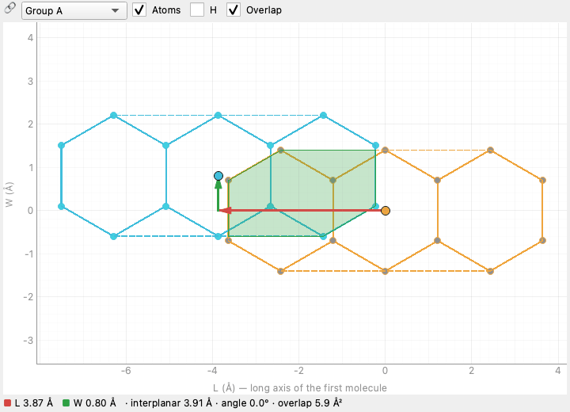

**Pair types.** With the default thresholds (those of the original website):

* **π-stack**: nearly parallel planes (angle ≤ 20°), close (interplanar distance ≤ 4.2 Å) and overlapping;
* **parallel**: nearly parallel planes, but too far apart or not overlapping;
* **tilted**: angle between the planes above 20° (T-shaped and herringbone contacts).

## 2. Installing and starting

You need Python 3.11–3.13. From the project folder:

```bash
./start.py
```

The first time `start.py` creates the `.venv/` environment and installs the packages (`requirements.txt`): numpy,
scipy, PySide6, PyVista, pyqtgraph. Later starts are immediate. Useful options:

```bash
./start.py examples/herringbone_anthracene.cif    # open a file
./start.py --lang en                              # English interface
./start.py --python /path/to/python3.12           # a Python other than the default one
./start.py --reinstall                            # redo the installation
./start.py --dev                                  # also install pytest and ruff
```

PISTAK can also be installed as a package, with the `pistak` command:

```bash
pip install -e ".[gui]"
pistak gui
```

Without arguments the window opens with a demonstration crystal (stacked naphthalene). A file is opened from
**File ▸ Open CIF…** (Ctrl+O), by dropping it onto the window, or from **File ▸ Recent files**.

## 3. A guided first example

1. **File ▸ Open CIF…** and choose `examples/herringbone_anthracene.cif` (herringbone anthracene, P2₁/c).
2. The **Table** lists two pairs: a *π-stack* between a molecule and its copy translated by `[0 -1 0]` (interplanar
   distance 3.91 Å, longitudinal slip 3.87 Å) and a *tilted* pair between the two independent molecules (angle
   89.4°: the T contact of the herringbone).
3. Click the first row: the **3D** view shows the pair (molecule B has cyan carbons, the other molecules of the
   column are light grey), the **Projection** shows the top view with the overlap.
4. In the **3D** view try *Side view* (you read the interplanar distance) and *From above* (you read the slip).
5. Open **Detail ▸ Pair**: all the parameters of the pair, grouped; **Detail ▸ Columns**: two infinite columns along
   b, step 5.56 Å.
6. Open **Analysis ▸ Live thresholds** (Ctrl+Shift+L) and bring the maximum interplanar distance below 3.9 Å: the
   pair becomes *parallel* and the columns disappear, without re-running the analysis.

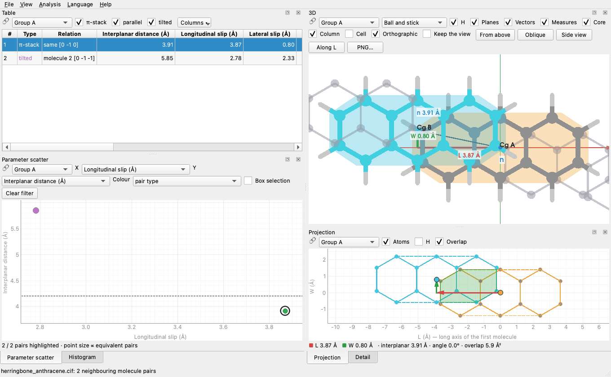

## 4. The main window

The window is made of **panels** (views) that can be dragged, placed side by side, stacked as tabs or detached into
a window of their own. **View ▸ New view (detached window)** opens more copies of any view; **View ▸ Reset the
layout** goes back to the initial one. The window never exceeds the screen and the panels can be shrunk a lot.

**Synchronisation.** At the top left of every view there is the 🔗 selector:

* **Group A / B / C**: the views of the same group share the selected pair and the filter. A click on a point of the
  scatter selects the row in the table and shows that pair in the 3D and projection views.
* **Not synchronised**: the view keeps its own selection, useful to compare two pairs side by side (open a second
  3D view with *View ▸ New view (detached window)* and put it in group B).

**Filters.** In the scatter, *Box selection* keeps only the pairs inside the rectangle; in the histogram a click on a
bar keeps that interval. The filter applies to the whole group: the table shows only those pairs (*All pairs*
removes it).

**Menus.**

| menu | items |
|---|---|
| File | open CIF, open the demo crystal, recent files, save/open session, reopen the last session, **Export** (CSV, JSON, XYZ, quantum chemistry, PNG of the 3D view) |
| View | new view, reset the layout, **Theme** (automatic like the system, light, dark: the window rebuilds itself and keeps everything) |
| Analysis | Thresholds… (Ctrl+,), Live thresholds (Ctrl+Shift+L), Re-analyse (Ctrl+R), Uncertainties (Monte Carlo), plugins, list of parameters, Comparison and statistics (Ctrl+Shift+C), Process a folder of CIF files |
| Language | Italian / English (the window rebuilds itself and keeps everything) |
| Help | Manual (F1), About |

## 5. The views

### Table

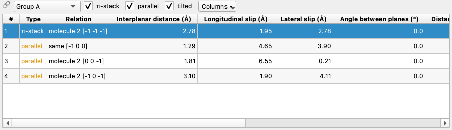

One row per pair, in this order: π-stacks first, then parallel, then tilted pairs, each group by increasing
interplanar distance. **Relation** says which molecules form the pair: `same [0 -1 0]` (the molecule and its
translated copy), `molecule 2 [1 0 0]` and, when molecules have several fragments, which ones (`· π2–π1`,
`intramolecular · π1–π3`). The *π-stack / parallel / tilted* boxes hide a type; **Columns ▾** chooses the parameters
to show (all those of the registry, plugins included). Click a header to sort; widths can be adjusted by hand.

### Parameter scatter

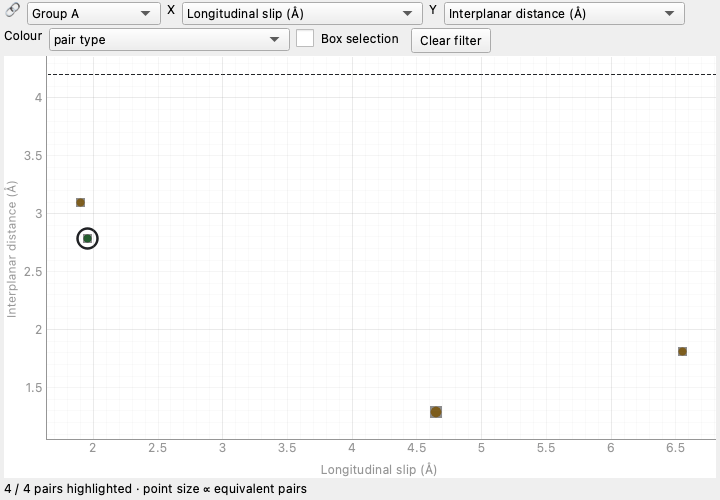

Each pair is a point; X and Y are any two parameters, the colour is the pair type or a third parameter (viridis
scale). The point grows with the number of symmetry-equivalent pairs. When an axis shows a parameter of the stack
criterion, the threshold is a dashed line (here the maximum interplanar distance, 4.2 Å) that follows the live
threshold panel. *Box selection* filters pairs, *Clear filter* removes the filter.

### Histogram

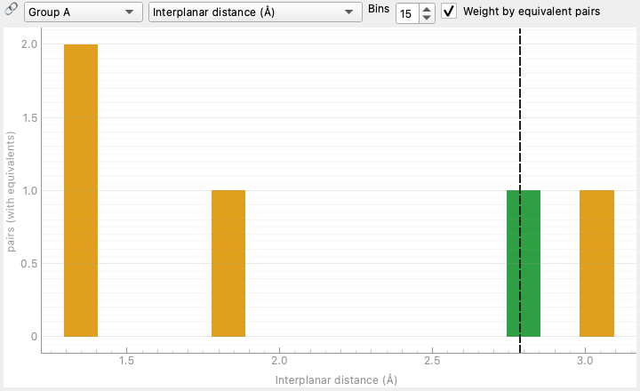

Distribution of a parameter, stacked by pair type (green π-stack, orange parallel, purple tilted); *Bins* sets the
number of bars, *Weight by equivalent pairs* counts each pair as many times as its symmetry copies. The dashed line is
the value of the selected pair. A click on a bar = filter.

### 3D

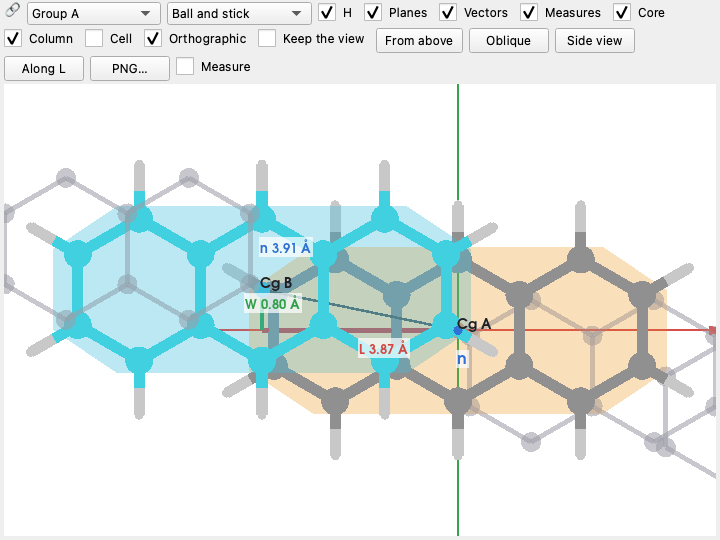

The selected pair: molecule A with element colours and an orange mean plane, molecule B with cyan carbons and plane;
*Core* enlarges the atoms of the π cores, *H* shows hydrogens; with *Column* the other molecules of the stack column
appear in light grey. *Planes* draws the mean planes, *Vectors* the slip decomposition (L red, W green, interplanar
distance blue), *Measures* the L, W, n axes through Cg A with the value of each component (the same as in the
table), *Cell* the cell edges. Styles: ball and stick, sticks, space-filling (vdW). Preset views: *From above*
(perpendicular to the planes), *Oblique*, *Side view*, *Along L*. The 3D view starts *From above* with an
*Orthographic* projection (no perspective): L to the right, W up, same centre as the **Projection**, so the two views
match; until you move the camera the framing follows the panel size. Untick *Orthographic* to get perspective back.
*Keep the view*: when the pair changes the camera keeps its angle and zoom *relative to the pair* (L, W, n axes, origin
at Cg A) instead of going back to the view from above, to compare different pairs from the same viewpoint. *PNG…*
saves the image redrawn three times larger than the panel, with text and lines to scale (`export_scale` in the `[gui]`
section of `user.toml`).

### Projection

The pair projected onto its mean plane, in the (L, W) frame: heavy atoms and bonds, fragment outlines (dashed), overlap
area (green), centroids, slip split into L and W. The values are listed below. *Atoms*, *H* and *Overlap* switch the
elements on and off. It is the figure of the original website.

### Detail

Six tabs:

| tab | content |
|---|---|
| Structure | file, block, space group, cell, atoms in the cell, molecules (formula, how many with a π core, fragments), discarded disordered atoms, excluded extended parts, thresholds in use |
| Pair | all parameters of the selected pair, by group; with uncertainties, "value ± σ" |
| Rings | planar ring pairs, one ring per molecule (Janiak style): Cg···Cg, α (angle between planes), β and γ (Cg→normal of A and of B), perpendicular distances ⟂A and ⟂B, slippage, closest contact; up to `ring_pair_max_distance` |
| Columns | stack columns: type (aggregate, column, layer, 3D network), molecules, step, axis, mean geometry |
| Warnings | plugins that failed to load and parameters that raised errors, with the message |
| Contacts | summary per molecule contact: fragment pairs, how many π-stacks, shortest contact, best pair (double click selects it) |

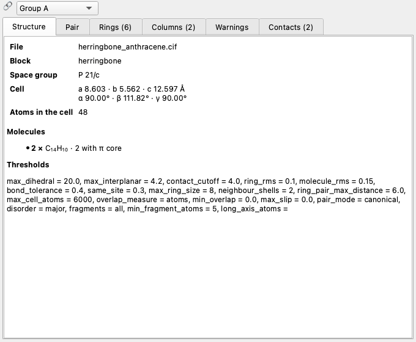

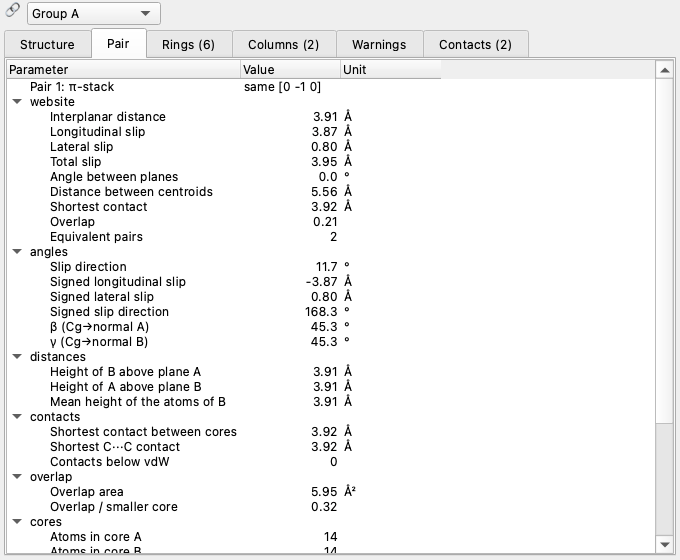

## 6. Measured quantities

Every quantity is a *registry parameter*: it appears in the table, on the scatter and histogram axes, in the Detail
view and in the exports, with a fixed key (English, the same in every language). `pistak params` lists them all.

**Website parameters** (group *website*)

| key | name | unit | meaning |
|---|---|---|---|
| `interplanar` | Interplanar distance | Å | \|**d**·**n**\| |
| `long_slip` | Longitudinal slip | Å | slip component along L |
| `lat_slip` | Lateral slip | Å | component along W |
| `slip` | Total slip | Å | \|**s**\| |
| `dihedral` | Angle between planes | ° | angle between the normals (0–90°) |
| `centroid_distance` | Distance between centroids | Å | \|**d**\| |
| `contact` | Shortest contact | Å | shortest distance between heavy atoms of the two molecules |
| `overlap` | Overlap | – | fraction of the atoms of one core inside the outline of the other |
| `count` | Equivalent pairs | – | symmetry-equivalent contacts collected in the pair |

**Additional parameters**

| key | meaning |
|---|---|
| `slip_angle` | slip direction relative to L, 0–90° (0 = purely longitudinal) |
| `long_slip_signed`, `lat_slip_signed` | signed components of **s**, from A towards B |
| `slip_direction` | signed direction of **s**, −180…180°, from L towards W |
| `beta_a`, `beta_b` | angle between **d** and the normal of A (β) or B (γ), Janiak style |
| `height_b_over_a`, `height_a_over_b` | height of the centroid of B above the plane of A and vice versa |
| `mean_atom_height` | mean height of the atoms of core B above the plane of A |
| `core_contact`, `cc_contact` | shortest contact between the cores; between two carbons |
| `n_vdw_contacts` | pairs of heavy atoms closer than the sum of their van der Waals radii |
| `overlap_area` | common area of the projected outlines (Ų) |
| `overlap_ratio` | common area / area of the smaller outline (0–1) |
| `core_size_a/b`, `core_rms_a/b` | atoms and planarity of the two cores |
| `fragment_a/b` | number of the π fragment of A and of B |
| `axis_aspect_a/b` | core isotropy: close to 1 the long axis is not defined (coronene, porphyrins) |

**Signed slips.** The unsigned versions cannot tell whether B is shifted "forward" or "backward" along L. The signed
ones can, but the sign is physically meaningful only when the axis is defined by two atoms (see
[Long axis](#9-analysis-conventions)) and the molecule does not sit on an inversion centre, which reverses the axis.
Swapping A and B changes the sign.

## 7. Classification and thresholds

A pair is:

1. **tilted** if the angle between the planes exceeds `max_dihedral`;
2. otherwise a **π-stack** if the interplanar distance is at most `max_interplanar`, the overlap exceeds
   `min_overlap` and, when `max_slip` > 0, the total slip is at most `max_slip`;
3. otherwise **parallel**.

The overlap of the criterion is measured as the fraction of atoms inside the outline of the other core
(`overlap_measure = "atoms"`, the website: one atom is enough) or as common area / area of the smaller core
(`"area"`, stricter and continuous: with `min_overlap = 0.3` at least 30% of the area must be covered).

Thresholds are changed from **Analysis ▸ Thresholds…** (all of them), from the **Live thresholds** panel (those of the
criterion), from `user.toml` or on the command line.

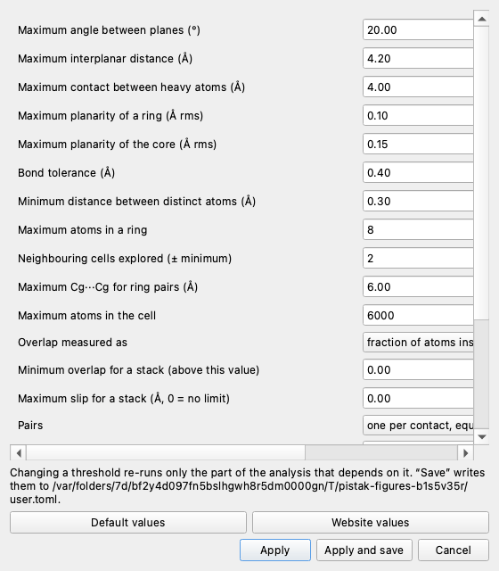

| threshold | default | meaning |
|---|---|---|
| `max_dihedral` | 20° | above it, the pair is tilted |
| `max_interplanar` | 4.2 Å | above it, no π-stack |
| `contact_cutoff` | 4.0 Å | two molecules are neighbours if they have heavy atoms closer than this |
| `overlap_measure` | atoms | how the overlap is measured (atoms / area) |
| `min_overlap` | 0 | minimum overlap for a π-stack |
| `max_slip` | 0 Å | maximum slip for a π-stack (0 = no limit) |
| `ring_rms` | 0.10 Å | maximum non-planarity of a ring |
| `molecule_rms` | 0.15 Å | maximum non-planarity of the whole core |
| `max_ring_size` | 8 | maximum atoms in a ring |
| `bond_tolerance` | 0.4 Å | bond if the distance is below the sum of covalent radii plus this |
| `same_site` | 0.3 Å | two positions closer than this are the same atom |
| `neighbour_shells` | 2 | neighbouring cells explored (a minimum: in canonical mode it grows by itself) |
| `ring_pair_max_distance` | 6.0 Å | maximum Cg···Cg for the ring table |
| `max_cell_atoms` | 6000 | limit of atoms in the cell |
| `pair_mode` | canonical | how pairs are collected (canonical / site) |
| `disorder` | major | which disordered atoms to keep |
| `fragments` | all | all π fragments or only the largest |
| `min_fragment_atoms` | 5 | minimum atoms of a secondary fragment |
| `long_axis_atoms` | (empty) | long axis from two labels, e.g. `C1,C9` |

**Website values** (in the thresholds dialog) restores the conventions of the original analyser:
`pair_mode = site`, `disorder = first`, `fragments = largest`.

## 8. Live thresholds

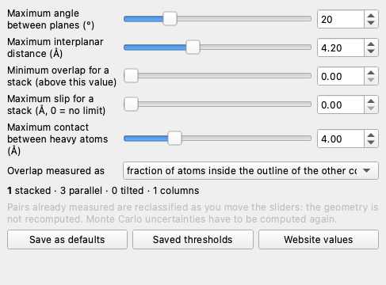

**Analysis ▸ Live thresholds** (Ctrl+Shift+L) opens a panel with a slider for each threshold of the stack criterion.
While you move a slider the pairs are reclassified at once: table, scatter (with the threshold lines), histogram,
columns and the counts at the bottom of the panel follow the slider; the selected pair and the filters stay the
same. You see at a glance how much a classification depends on the thresholds.

Why it is fast: the analysis is split into **stages**, and every threshold belongs to exactly one.

| stage | thresholds | what is redone |
|---|---|---|
| cif | `disorder` | reading the file |
| structure | `bond_tolerance`, `same_site`, `max_cell_atoms` | cell, bonds, molecules |
| fragments | `ring_rms`, `molecule_rms`, `max_ring_size`, `fragments`, `min_fragment_atoms`, `long_axis_atoms` | rings, fragments, axes |
| contacts | `contact_cutoff`, `neighbour_shells`, `pair_mode` | measuring all pairs (the expensive part) |
| pairs | `max_dihedral`, `max_interplanar`, `min_overlap`, `max_slip`, `overlap_measure`, `ring_pair_max_distance` | classification, grouping, columns |

Changing a threshold restarts from its stage and reuses the rest. With the thresholds of the stack criterion no
geometry is measured again (a few milliseconds). The *maximum contact* instead decides which pairs to measure: it is
applied when you release the slider, in a background thread.

*Save as defaults* writes the thresholds to `user.toml`; *Saved thresholds* goes back to them; *Website values* sets
the criterion of the website. After a change of thresholds the Monte Carlo uncertainties must be computed again.

## 9. Analysis conventions

**Pairs: canonical or site** (`pair_mode`).

* `canonical` (default): each contact between two molecules appears once. Two contacts are the same pair if an
  operation of the space group maps one onto the other; *Equivalent pairs* counts the contacts per cell. The axis L is
  the bisector of the long axes of the two fragments, so the slips do not depend on which molecule is called A. The
  explored neighbouring cells grow by themselves as needed (small or very oblique cells).
* `site`: like the original website. Each contact appears twice (a→b and b→a, with slips that can differ, because L
  is the axis of the first molecule); "equivalent" pairs are recognised from rounded values; always
  ±`neighbour_shells` cells are explored. Use it to compare numbers with the website.

**π fragments** (`fragments`). With `all`, a molecule with several separate aromatic systems (a twisted biphenyl, a
ligand with several rings) has one fragment per system; pairs are between fragments, including those between
fragments of the same molecule (*intramolecular*). **Detail ▸ Contacts** groups fragment pairs per molecule contact.
With `largest` only π1 counts, as on the website.

**Long axis** (`long_axis_atoms`). Empty: the direction of largest extent of the fragment. For nearly isotropic cores
(*Isotropy of core A/B* close to 1: benzene, coronene, porphyrins) that direction is ill-defined, and so is the split of the
slip into L and W. With two CIF labels (`C1,C9`) the axis goes from the first atom to the second, projected onto the
plane, for the fragments that contain them. If a label occurs several times in the molecule (molecule on a symmetry
element) the most distant pair is taken: even `C1,C1` works.

**Disorder** (`disorder`). `major` (default): for each disorder assembly keeps the group with the highest mean
occupancy; `first`: group 1 (the website); `all`: all atoms; a number: that group. **Detail ▸ Structure** says how
many atoms were discarded (and `skipped_disorder_atoms` in the JSON).

**Several structures in one file.** Each `data_` block with atoms is a structure: the window asks which one to open,
the comparison analyses all of them ("file.cif [block]"), `analyze --block NAME` picks one.

**Missing symmetry operations.** If the CIF does not list them they are derived from the Hall symbol or the
Hermann–Mauguin symbol (table of the most common groups; all of them with the optional `gemmi` package). The JSON
export says where they come from (`symops_source`).

**Extended molecules.** If the bond network does not close (polymers, MOFs, extended ionic solids) those parts are
excluded from the analysis and reported in **Detail ▸ Structure**.

## 10. Stack columns

π-stacked pairs are the edges of a graph over the molecules of the crystal. Walking it, PISTAK recognises the
**columns**, classified by *rank* (how many independent stacking directions they have):

| rank | type | example |
|---|---|---|
| 0 | finite aggregate | isolated dimer, trimer |
| 1 | column | infinite stacking along one axis (the classic case) |
| 2 | layer | molecules stacked in two directions |
| 3 | 3D network | stacking contacts in three directions |

For the columns, **Detail ▸ Columns** gives the step (Å), the axis in cells, the mean geometry and the angle between
the column axis and the plane normal; the 3D view, with *Column*, shows the other molecules of the column.

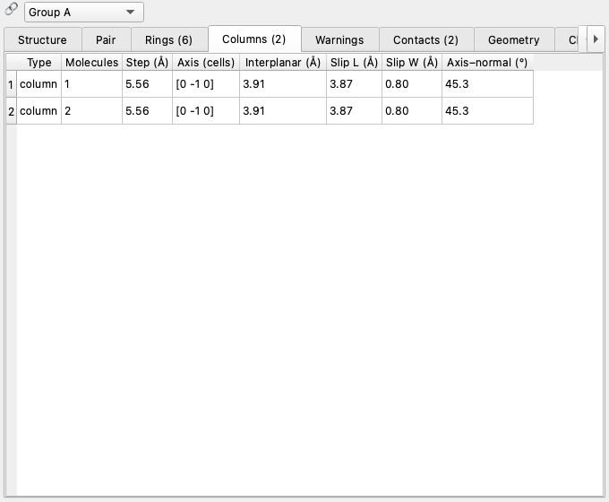

## 11. Monte Carlo uncertainties

**Analysis ▸ Uncertainties (Monte Carlo)…** estimates the standard deviation σ of every parameter from the standard
uncertainties (s.u.) of the CIF, the digits in parentheses: `0.1234(5)`. For N samples (200 is a good value) the
coordinates of every atom of the asymmetric unit are displaced at random according to their s.u. (and, optionally,
the cell parameters); the displacement is passed to the symmetry copies through the operation that generates them,
so equivalent molecules move consistently. Planes and axes are recomputed and every pair is measured again: σ is
the standard deviation over the samples. For every pair PISTAK also computes the fraction of samples in which the
type (stack/parallel/tilted) stays the same (*kind_agreement*): below 1 the classification is at the edge of the
thresholds.

The Detail view shows "value ± σ"; the CSV adds the `<key>_su` and `kind_agreement` columns, the JSON a `su` field
per pair. On the command line: `analyze file.cif --mc 200`.

Approximations (the same as crystallographic programs without the full covariance matrix): independent coordinates,
special positions not constrained, atoms without s.u. kept fixed. A large σ on the L and W slips of a nearly isotropic
core says that the long axis is not defined: fix it with two atoms.

## 12. Comparison and statistics across structures

**Analysis ▸ Comparison and statistics…** (Ctrl+Shift+C) opens a window where you add CIF files and folders (*Add
CIF…*, *Add folder…* or by dropping them): the analysis runs in parallel and all pairs of all files end up in the same
table. The *Pairs* filter (π-stack only, parallel, tilted, all) and *Weight by equivalent pairs* apply to every tab.

| tab | content |
|---|---|
| Structures | for each structure the closest π-stacked pair, the differences Δ from the reference (right click ▸ *Set as reference*) and the *motif distance*: the distance (Å) in the space (interplanar, slip L, slip W) between the two most similar stacking motifs. Double click: opens the file in the main window |
| Distributions | histogram of any parameter, stacked by type or by file |
| Scatter | two parameters, colour by type, file or a third parameter; *Open in the main window* jumps to the chosen pair |
| Correlations | Pearson matrix between the ticked parameters |
| Summary | mean, standard deviation, minimum, quartiles, maximum; one row per file |

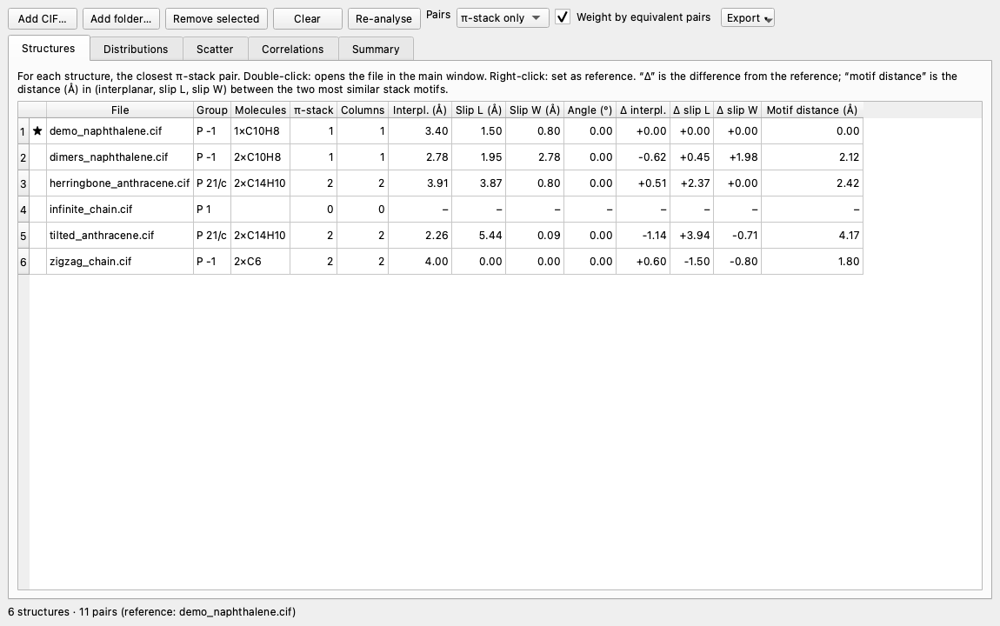

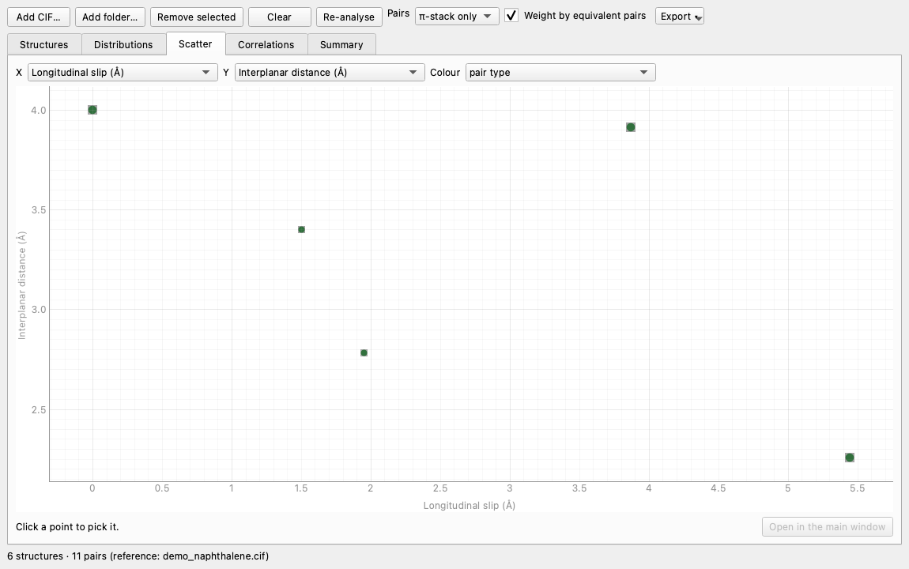

Everything can be exported to CSV from the *Export ▾* menu. On the command line: `compare` and `stats` (see
[The command line](#15-the-command-line)).

## 13. Exporting results

**File ▸ Export**:

* **Pairs table (CSV)**: one row per pair, columns `n, kind, molecule_a, molecule_b, shift` and then one parameter per
  column (the registry keys), plus `<key>_su` and `kind_agreement` when uncertainties are available.
* **Full results (JSON)**: `format`, `version`, `summary` (file, group, cell, molecules, thresholds, disorder,
  uncertainties), `units`, `fragments` (π fragments with the atom labels), `pairs` (with all parameters) and
  `molecule_contacts`.
* **Selected pair (XYZ)**: the two molecules, B already in the right cell, for any molecular viewer.
* **Selected pair for quantum chemistry**: see the next section.
* **3D view (PNG)**.

Headers and keys are fixed and in English, the same in every interface language: a script reading the files always
works. CSV example:

```text
n,kind,molecule_a,molecule_b,shift,interplanar,long_slip,lat_slip,slip,dihedral,...
1,stack,1,1,0 -1 0,3.9138,3.8692,0.80441,3.952,0,...
```

## 14. Dimer for quantum chemistry

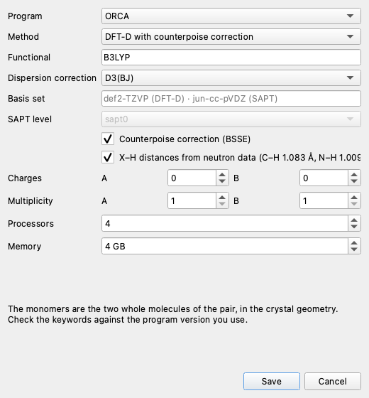

**File ▸ Export ▸ Selected pair for quantum-chemistry calculations…** writes the **ORCA**, **Psi4** or **Gaussian** input of the
dimer of the selected pair, to compute its interaction energy.

* **Monomers**: the two whole molecules of the pair, in the crystal geometry (B already translated into the right
  cell). Even for a contact between fragments, the energy is that of the whole dimer.
* **Hydrogens**: X–H distances from X-ray diffraction are too short; by default every X–H bond is lengthened along
  the bond to the mean neutron-diffraction distances (C–H 1.083 Å, N–H 1.009 Å, O–H 0.983 Å, B–H 1.19 Å,
  S–H 1.338 Å). Heavy atoms do not move.
* **DFT-D** (default B3LYP-D3(BJ)/def2-TZVP) with counterpoise correction (Boys–Bernardi):
  E_int = E(AB) − E(A in the AB basis) − E(B in the AB basis). ORCA: three calculations in the same file (`$new_job`)
  with ghost atoms; Psi4: `bsse_type='cp'`; Gaussian: `Counterpoise=2` with fragments (Gaussian has no D4).
* **SAPT** (Psi4 only, default SAPT0/jun-cc-pVDZ): the energy split into electrostatics, exchange, induction and
  dispersion, useful to understand *why* a stack is stable.
* Charges and multiplicities of the monomers, processors and memory go into the program headers.

The file starts with a comment saying where it comes from (CIF, block, pair, distances, moved hydrogens) and is pure
ASCII; like the other exports, comments and file name are in English in every language
(`herringbone_anthracene_pair1_dftd.inp`). Example (ORCA, first lines):

```text
# PISTAK: herringbone_anthracene.cif [herringbone] pair 1 (stack)
# molecule 1 + molecule 1 translated by [0 -1 0]
# interplanar 3.914 A, slip L 3.869 A, W 0.804 A, angle 0.0 deg, contact 3.922 A
# X-H distances set to neutron values (20 hydrogens moved)
# experimental crystal geometry, not optimised
# DFT-D with counterpoise correction (Boys-Bernardi): E_int = E(AB) - E(A in AB basis) - E(B in AB basis)
# --- dimer AB
! B3LYP D3BJ def2-TZVP TightSCF DefGrid2
%pal nprocs 4 end
%maxcore 1000
* xyz 0 1
C          -0.93338175     0.74220151     0.73344970
```

On the command line, for example all the stacks of a file as SAPT inputs for Psi4:

```bash
./start.py qc a.cif --program psi4 --method sapt -o inputs/
```

Intramolecular pairs are not exported (they are not a dimer). The keywords follow the current versions (ORCA 5–6,
Psi4 1.7+, Gaussian 16): check them against the version you use.

## 15. The command line

Everything the window does can also be done on the command line (`./start.py COMMAND …` or `pistak COMMAND …`).

| command | purpose |
|---|---|
| `analyze file.cif` | analyse a file and print the pairs; `--csv`, `--json`, `--xyz N FILE`, `--block`, `--mc N` |
| `batch folder/` | all CIFs of a folder, in parallel; `--csv summary.csv` |
| `compare a.cif b.cif …` | compare the stacking motif; `--ref N` chooses the reference |
| `stats folder/` | statistics on the pairs; `--kind stack`, `--keys`, `--corr`, `--csv`, `--summary` |
| `qc file.cif` | dimer input for ORCA, Psi4, Gaussian (see above) |
| `params` | list the available parameters, plugins included |
| `config` | where personal settings, the last session and plugins are |
| `demo` | write the demonstration CIF |
| `gui` | open the window |

Every analysis command accepts the thresholds: `--max-dihedral`, `--max-interplanar`, `--contact-cutoff`,
`--pair-mode`, `--disorder`, `--overlap-measure`, `--min-overlap`, `--max-slip`. `--lang en` (or `PISTAK_LANG=en`)
changes the language of the messages.

**Example: one file.**

```text
$ ./start.py --lang en analyze examples/herringbone_anthracene.cif
herringbone_anthracene.cif  group P 21/c  a=8.603 b=5.562 c=12.597  α=90.00 β=111.82 γ=90.00  atoms in cell: 48
  2 × C14H10  (2 with π core)
  # type     interpl.  L-slip  W-slip dihedral   Cg-Cg  contact  relation
  1 stack        3.91    3.87    0.80     0.0    5.56     3.92  same [0 -1 0]
  2 tilted       5.85    2.78    2.33    89.4    6.88     2.45  molecule 2 [0 -1 -1]
```

**Example: comparing a folder**, against the first structure.

```text
$ ./start.py --lang en compare examples/ --ref 1
file                         stack col interplan long_slip  lat_slip  dihedral   Δ vs. ref.           motif dist.
demo_naphthalene.cif             1   1      3.40      1.50      0.80      0.00    +0.00  +0.00  +0.00     0.00 Å
dimers_naphthalene.cif           1   1      2.78      1.95      2.78      0.00    -0.62  +0.45  +1.98     2.12 Å
herringbone_anthracene.cif       2   2      3.91      3.87      0.80      0.00    +0.51  +2.37  +0.00     2.42 Å
```

**Example: statistics on the stacks of a folder.**

```text
$ ./start.py --lang en stats examples/ --kind stack
parameter                n     mean std.dev.      min      q25   median      q75      max
interplanar              8    3.316    0.723    2.258    2.609    3.571    3.957    4.000
long_slip                8    2.760    2.072    0.000    1.000    2.591    4.657    5.444
```

**Example: stricter thresholds and uncertainties.**

```bash
./start.py analyze a.cif --overlap-measure area --min-overlap 0.3 --max-slip 2.5 --mc 200 --csv a.csv
```

## 16. Sessions

**File ▸ Save session…** writes a `.pistak` file (readable JSON) with the CIF embedded (the session opens even if
you move the file), the thresholds, the selected pair and the filter of each group, the views with their settings
(axes, columns, 3D options and camera), the panel layout and the files of the comparison window. Reopen it from
**File ▸ Open a session…**, by dropping the file onto the window, or with `./start.py session.pistak`. On closing,
the last session is saved automatically: **File ▸ Reopen the last session**.

## 17. Personal settings

Personal settings live outside the program, in the user's folder (`./start.py config` shows it):

* macOS `~/Library/Application Support/PISTAK/`
* Windows `%APPDATA%\PISTAK\`
* Linux `~/.config/pistak/`
* or the one given by the `PISTAK_CONFIG_DIR` variable.

It contains `user.toml`, `last.pistak` (the last session) and `plugins/`. In `user.toml` you write only what you want
to change with respect to `pistak/default.toml`:

```toml
[limits]
max_interplanar = 3.8
overlap_measure = "area"
min_overlap = 0.25
long_axis_atoms = "C1,C9"

[gui]
language = "en"          # it | en | auto
show_hydrogens = false
sphere_scale = 0.3
```

## 18. PISTAK as a Python library

The computation does not depend on the window: use it from a script or a notebook.

```python
from pistak import api
from pistak.core.config import Limits

a = api.analyse_file("examples/herringbone_anthracene.cif", Limits())
for p in a.pairs:
    print(p.index + 1, p.kind, round(p.interplanar, 2), round(p.get("long_slip_signed"), 2))

stack = next(p for p in a.pairs if p.kind == "stack")
ctx = a.pair_context(stack)            # everything about the pair: molecules, cores, (L, W, n) frame
print(ctx.frame.n, ctx.core_a.centroid)

b = api.reanalyse(a, a.limits.with_values(max_interplanar=3.8))   # redoes only the stage needed
u = api.uncertainty(a, samples=200)                                # σ from the s.u. of the CIF
print(u.get(stack, "interplanar"))

from pistak.io import export, qc
export.write_json(a, "a.json")
print(qc.dimer_input(a, stack, qc.QCOptions("psi4", "sapt")))
```

For many structures, in parallel:

```python
from pistak.io import batch, compare

entries = batch.run_batch(batch.find_cifs("folder/"), Limits())   # one entry per data_ block
for row in compare.compare(entries, reference=0):
    print(row)
```

`pistak.io.stats` computes statistical descriptions, correlations and histograms on the same entries.

## 19. New parameters with plugins

A parameter is a function that receives the pair context and returns a number. Copy `plugins/example_param.py` into
the `plugins/` folder (of the project or of the personal settings), edit it and use **Analysis ▸ Reload plugins**:
the parameter appears in the table, on the axes, in the Detail view and in the exports.

```python
from pistak.params import parameter


@parameter("slip_over_distance", "Slip / centroid distance", unit="", group="plugin", digits=3,
           description="0 = cores on top of each other, 1 = side by side.")
def slip_over_distance(ctx):
    return ctx.pair.slip / ctx.pair.centroid_distance
```

The context `ctx` holds the pair (`ctx.pair`), the two molecules (`ctx.A`, `ctx.B`), the cores (`ctx.core_a`,
`ctx.core_b`), the pair frame (`ctx.frame.L/W/n`), the positions (`ctx.pos_a`, `ctx.pos_b`, with B already in the
right cell), the thresholds and the whole analysis. If the value depends only on the geometry of the pair, declare it
with `geometric=True`: it will be reused when the stack thresholds change instead of being recomputed. A plugin that
fails gives NaN for that pair and the error appears in **Detail ▸ Warnings**: it does not stop the analysis.

## 20. Troubleshooting

**"No pair with π cores".** The molecule has no ring planar enough: try raising `ring_rms` and `molecule_rms`, or
check in **Detail ▸ Structure** whether the molecules are "extended" (bond network that does not close).

**The structure has disordered atoms.** With `disorder = major` the major component is kept; for the minor one use
the group number (`--disorder 2`), for everything `all`. **Detail ▸ Structure** says how many atoms were discarded.

**"Too many atoms in the cell".** Large structures (proteins, MOFs): raise `max_cell_atoms` in the thresholds.

**L and W slips change a lot with small variations.** The core is nearly isotropic (*Isotropy of core A/B* close to 1): fix
the long axis with two atoms (`long_axis_atoms`).

**The numbers differ from those of the website.** Use *Website values* in the thresholds dialog (or
`--pair-mode site --disorder first`): the default conventions of PISTAK are different (see
[Conventions](#9-analysis-conventions)).

**The 3D view does not appear.** It needs OpenGL, which may be missing on remote or virtual machines. The other views
work anyway; `PISTAK_NO_3D=1` disables it altogether.

**The terminal shows "qt.qpa.window: Can not manage visual effect areas…".** It is a harmless macOS warning about the
3D window; PISTAK filters it.

**`._name` files appear on exFAT or FAT disks.** macOS creates them; PISTAK ignores them and `start.py` removes them
from the environment. If possible, keep the project on an APFS disk.
