# Manuale di PISTAK

*Analisi del π-stacking da file CIF — manuale d'uso.* [English version](en.md)

PISTAK legge una struttura cristallina (file CIF), ricostruisce le molecole intere, trova i sistemi aromatici planari
(i *nuclei π*) e misura, per ogni coppia di molecole a contatto, come sono impilati: distanza tra i piani,
slittamento lungo l'asse lungo e lungo l'asse corto, angolo tra i piani, sovrapposizione. Classifica le coppie in
π-stack, parallele e inclinate, ricostruisce le colonne di impilamento e permette di confrontare molte strutture.

Il manuale è anche nella finestra: **Aiuto ▸ Manuale** (F1). Le figure usano i CIF sintetici della cartella
`examples/`, che non sono misure sperimentali.

## Indice

1. [Concetti di base](#1-concetti-di-base)
2. [Installazione e avvio](#2-installazione-e-avvio)
3. [Primo esempio guidato](#3-primo-esempio-guidato)
4. [La finestra principale](#4-la-finestra-principale)
5. [Le viste](#5-le-viste)
6. [Grandezze misurate](#6-grandezze-misurate)
7. [Classificazione e soglie](#7-classificazione-e-soglie)
8. [Soglie in tempo reale](#8-soglie-in-tempo-reale)
9. [Convenzioni dell'analisi](#9-convenzioni-dellanalisi)
10. [Colonne di stack](#10-colonne-di-stack)
11. [Incertezze con il Monte Carlo](#11-incertezze-con-il-monte-carlo)
12. [Confronto e statistiche su più strutture](#12-confronto-e-statistiche-su-più-strutture)
13. [Esportare i risultati](#13-esportare-i-risultati)
14. [Dimero per calcoli quantistici](#14-dimero-per-calcoli-quantistici)
15. [Il terminale](#15-il-terminale)
16. [Sessioni](#16-sessioni)
17. [Impostazioni personali](#17-impostazioni-personali)
18. [PISTAK come libreria Python](#18-pistak-come-libreria-python)
19. [Parametri nuovi con i plugin](#19-parametri-nuovi-con-i-plugin)
20. [Problemi frequenti](#20-problemi-frequenti)

## 1. Concetti di base

**Nucleo π e frammenti.** In ogni molecola PISTAK cerca gli anelli planari (scarto quadratico dal piano medio sotto
`ring_rms`) e li unisce in sistemi condensati. Ogni sistema planare è un *frammento π*: π1 è il più grande (il nucleo
π «classico»), π2, π3… gli altri, se hanno almeno `min_fragment_atoms` atomi. Di ogni frammento si calcolano il
baricentro (Cg), il piano medio con la sua normale **n** e l'*asse lungo* **L**, la direzione in cui il frammento è
più esteso (oppure quella definita da due atomi, vedi [Asse lungo](#9-convenzioni-dellanalisi)).

**Coppia.** Due frammenti di molecole vicine (atomi pesanti a meno di `contact_cutoff`, 4 Å per impostazione),
la seconda eventualmente traslata in un'altra cella: la traslazione si scrive come `[1 0 0]`, `[0 -1 0]`…

**Il sistema della coppia.** Per ogni coppia si costruisce un sistema di riferimento: **n** è la normale media dei
due piani, **L** l'asse lungo proiettato sul piano medio, **W** = **n** × **L** l'asse corto. Con **d** il vettore
che va dal baricentro di A a quello di B:

| grandezza | definizione |
|---|---|
| distanza interplanare | \|**d**·**n**\|: quanto B sta sopra il piano di A |
| slittamento **s** | **d** − (**d**·**n**)**n**: la parte di **d** nel piano |
| slittamento longitudinale | \|**s**·**L**\| |
| slittamento laterale | \|**s**·**W**\| |
| angolo tra i piani | angolo tra le normali dei due frammenti (0–90°) |
| sovrapposizione | quanto i contorni proiettati dei due frammenti si coprono |

La vista **Proiezione** mostra esattamente queste grandezze: i due frammenti proiettati sul piano medio, l'area
comune (verde), lo slittamento scomposto in L (rosso) e W (verde).

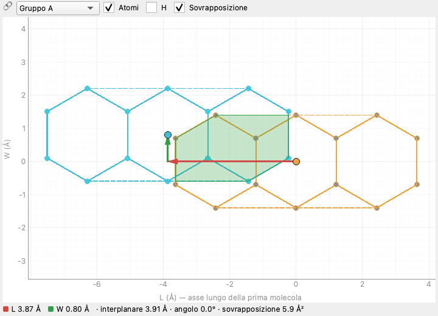

**Tipi di coppia.** Con le soglie predefinite (quelle del sito originale):

* **π-stack**: piani quasi paralleli (angolo ≤ 20°), vicini (distanza interplanare ≤ 4,2 Å) e sovrapposti;
* **parallela**: piani quasi paralleli ma troppo lontani o non sovrapposti;
* **inclinata**: angolo tra i piani oltre 20° (contatti a T, a spina di pesce).

## 2. Installazione e avvio

Serve Python 3.11–3.13. Dalla cartella del progetto:

```bash
./start.py
```

La prima volta `start.py` crea l'ambiente `.venv/` e installa i pacchetti (`requirements.txt`): numpy, scipy,
PySide6, PyVista, pyqtgraph. Le volte successive parte subito. Opzioni utili:

```bash
./start.py examples/herringbone_anthracene.cif    # apre un file
./start.py --lang en                              # interfaccia in inglese
./start.py --python /percorso/python3.12          # un Python diverso da quello predefinito
./start.py --reinstall                            # rifà l'installazione
./start.py --dev                                  # aggiunge pytest e ruff
```

In alternativa PISTAK si installa come pacchetto, con il comando `pistak`:

```bash
pip install -e ".[gui]"
pistak gui
```

Senza argomenti la finestra si apre con un cristallo dimostrativo (naftalene impilato). Un file si apre da
**File ▸ Apri CIF…** (Ctrl+O), trascinandolo sulla finestra o da **File ▸ Recenti**.

## 3. Primo esempio guidato

1. **File ▸ Apri CIF…** e scegli `examples/herringbone_anthracene.cif` (antracene a spina di pesce, P2₁/c).
2. La **Tabella** elenca due coppie: una *π-stack* tra una molecola e la sua traslata di `[0 -1 0]` (distanza
   interplanare 3,91 Å, slittamento longitudinale 3,87 Å) e una *inclinata* tra le due molecole indipendenti
   (angolo 89,4°: il contatto a T della spina di pesce).
3. Fai clic sulla prima riga: la **3D** mostra la coppia (la molecola B ha i carboni azzurri, le altre molecole
   della colonna sono grigio chiaro), la **Proiezione** la vista dall'alto con la sovrapposizione.
4. Nella **3D** prova i pulsanti *Di lato* (si legge la distanza interplanare) e *Dall'alto* (si legge lo slittamento).
5. Apri **Dettaglio ▸ Coppia**: tutti i parametri della coppia, raggruppati; **Dettaglio ▸ Colonne**: due colonne
   infinite lungo b, passo 5,56 Å.
6. Apri **Analisi ▸ Soglie in tempo reale** (Ctrl+Maiusc+L) e porta la distanza interplanare massima sotto 3,9 Å:
   la coppia diventa *parallela* e le colonne spariscono, senza rifare l'analisi.

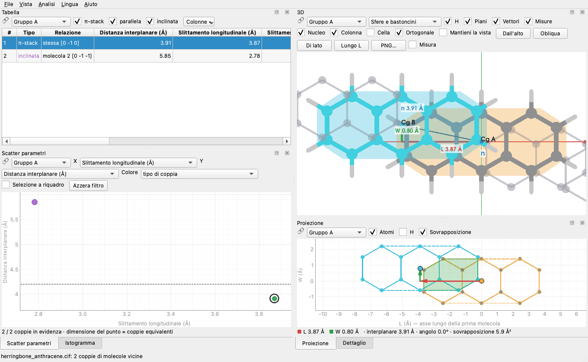

## 4. La finestra principale

La finestra è fatta di **pannelli** (viste) che si possono trascinare, affiancare, impilare a schede o staccare in una
finestra propria. **Vista ▸ Nuova vista (finestra staccata)** apre altre copie di qualunque vista; **Vista ▸ Reimposta la disposizione**
torna a quella iniziale. La finestra non supera mai lo schermo e i pannelli si possono rimpicciolire molto.

**Sincronizzazione.** In alto a sinistra di ogni vista c'è il selettore 🔗:

* **Gruppo A / B / C**: le viste dello stesso gruppo condividono la coppia selezionata e il filtro. Un clic su un
  punto dello scatter seleziona la riga nella tabella e mostra quella coppia nella 3D e nella proiezione.
* **Non sincronizzata**: la vista tiene una selezione sua, utile per confrontare due coppie affiancate (apri una
  seconda 3D con *Vista ▸ Nuova vista (finestra staccata)* e mettila nel gruppo B).

**Filtri.** Nello scatter *Selezione a riquadro* tiene solo le coppie dentro il rettangolo; nell'istogramma un clic su
una barra tiene quell'intervallo. Il filtro vale per tutto il gruppo: la tabella mostra solo quelle coppie (*Tutte le
coppie* lo toglie).

**Menu.**

| menu | voci |
|---|---|
| File | apri CIF, apri il cristallo dimostrativo, recenti, salva/apri sessione, riapri l'ultima, **Esporta** (CSV, JSON, XYZ, calcoli quantistici, PNG della 3D) |
| Vista | nuova vista, reimposta la disposizione, **Tema** (automatico come il sistema, chiaro, scuro: la finestra si ricostruisce conservando tutto) |
| Analisi | Soglie… (Ctrl+,), Soglie in tempo reale (Ctrl+Maiusc+L), Rianalizza (Ctrl+R), Incertezze (Monte Carlo), plugin, elenco dei parametri, Confronto e statistiche (Ctrl+Maiusc+C), Elabora una cartella di CIF |
| Lingua | italiano / inglese (la finestra si ricostruisce conservando tutto) |
| Aiuto | Manuale (F1), Informazioni |

## 5. Le viste

### Tabella

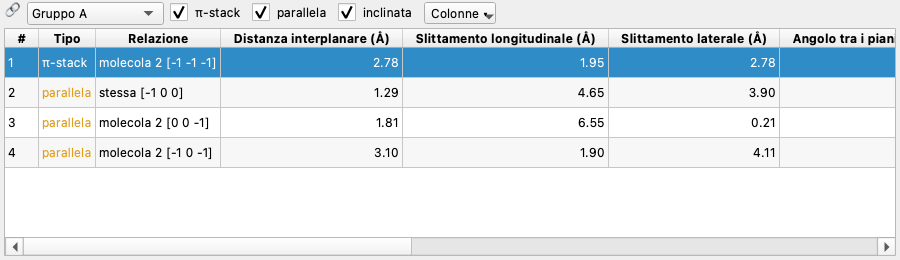

Una riga per coppia, nell'ordine: prima le π-stack, poi le parallele, poi le inclinate, ciascun gruppo per distanza
interplanare crescente. **Relazione** dice tra chi è la coppia: `stessa [0 -1 0]` (la molecola e la sua traslata),
`molecola 2 [1 0 0]`, e, se le molecole hanno più frammenti, quali (`· π2–π1`, `intramolecolare · π1–π3`). Le caselle
*π-stack / parallela / inclinata* nascondono un tipo; **Colonne ▾** sceglie i parametri da mostrare (tutti quelli
del registro, plugin compresi). Clic su un'intestazione per ordinare; le larghezze si regolano a mano.

### Scatter parametri

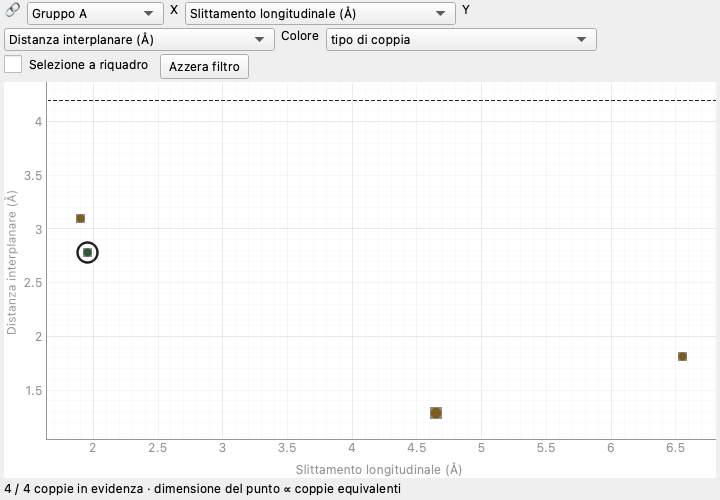

Ogni coppia è un punto; X e Y sono due parametri qualunque, il colore il tipo di coppia o un terzo parametro (scala
viridis). La dimensione del punto cresce con le coppie equivalenti per simmetria. Quando un asse mostra un parametro
del criterio di stack, la soglia è una linea tratteggiata (qui la distanza interplanare massima, 4,2 Å) che segue il
pannello delle soglie in tempo reale. *Selezione a riquadro* filtra le coppie, *Azzera filtro* lo toglie.

### Istogramma

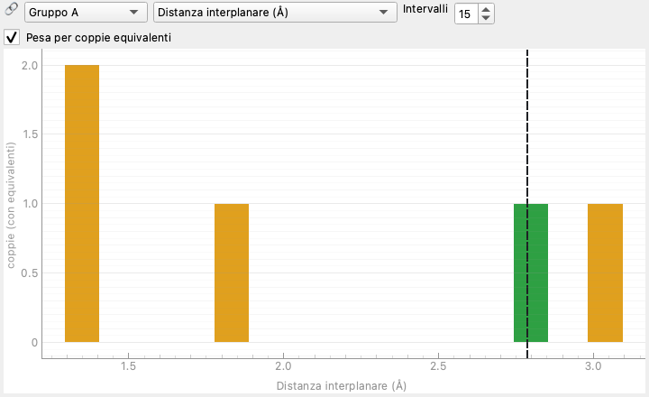

Distribuzione di un parametro, impilata per tipo di coppia (verde π-stack, arancione parallele, viola inclinate);
*Intervalli* sceglie il numero di barre, *Pesa per coppie equivalenti* conta ogni coppia tante volte quante sono le
sue copie per simmetria. La linea tratteggiata è il valore della coppia selezionata. Clic su una barra = filtro.

### 3D

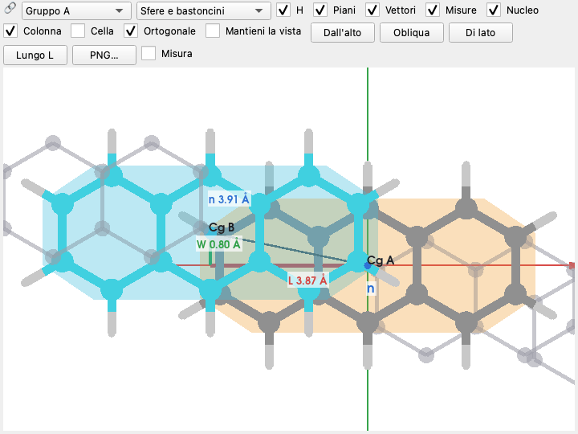

La coppia selezionata: la molecola A con i colori degli elementi e il piano medio arancione, la B con i carboni e il
piano azzurri; *Nucleo* ingrandisce gli atomi dei nuclei π, *H* mostra gli idrogeni; con *Colonna* le altre molecole
della colonna di stack in grigio chiaro. *Piani* disegna i piani medi, *Vettori* la scomposizione dello slittamento (L rosso,
W verde, distanza interplanare blu), *Misure* gli assi L, W, n che passano per Cg A con il valore di ogni componente
(gli stessi della tabella), *Cella* gli spigoli della cella. Stili: sfere e bastoncini, bastoncini, spazio
occupato (vdW). Le viste predefinite: *Dall'alto* (perpendicolare ai piani), *Obliqua*, *Di lato*, *Lungo L*.
La 3D parte *Dall'alto* e in proiezione *Ortogonale* (senza prospettiva): L a destra, W in alto, stesso centro
della **Proiezione**, così le due viste coincidono; finché non si muove la camera l'inquadratura segue le dimensioni
del pannello. Togliendo *Ortogonale* si torna alla prospettiva.
*Mantieni la vista*: cambiando coppia la camera conserva angolazione e zoom *rispetto alla coppia* (assi L, W, n, con
origine in Cg A), invece di tornare alla vista dall'alto: serve a confrontare coppie diverse dallo stesso punto di vista.
*PNG…* salva l'immagine ridisegnata tre volte più grande del pannello, con testi e linee in proporzione (`export_scale`
nella sezione `[gui]` di `user.toml`).

**Misure nella 3D.** Con *Misura* attivo un clic su un atomo lo sceglie (guscio arancione): con due atomi compare la
distanza, tratteggiata e scritta sulla linea e nella barra della vista (per esempio `C8···H4 (B) 2.843 Å`; «(B)» è
un atomo della seconda molecola), con un terzo anche l'angolo nel secondo atomo; un quarto clic ricomincia.
Trascinando, la vista ruota come sempre: conta solo il clic senza spostamento. Le misure finiscono anche nel *PNG…*;
togliendo *Misura* spariscono.

Un **doppio clic su una riga della scheda Geometria** del Dettaglio (un contatto, un legame, un angolo, una torsione)
mostra quella misura nella 3D: le molecole intere che contengono i suoi atomi, nella loro posizione nel cristallo
(la seconda con il carbonio ciano), gli atomi evidenziati con il codice di simmetria e il valore. Serve per esempio a
vedere un legame a idrogeno con una molecola d'acqua, che non ha un nucleo π e quindi non compare in nessuna coppia;
funziona anche nelle strutture senza coppie. Scegliendo una coppia la 3D torna alla coppia.

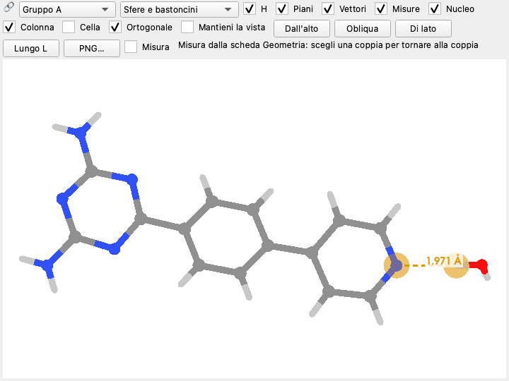

### Proiezione

La coppia proiettata sul piano medio, nel sistema (L, W): atomi pesanti e legami, contorni dei frammenti (tratteggiati),
area di sovrapposizione (verde), baricentri, slittamento scomposto in L e W. Sotto, i valori. *Atomi*, *H* e
*Sovrapposizione* accendono e spengono gli elementi. È la figura del sito originale.

### Dettaglio

Otto schede:

| scheda | contenuto |
|---|---|
| Struttura | file, blocco, gruppo spaziale, cella, atomi in cella, molecole (formula, quante con nucleo π, frammenti), atomi disordinati scartati, parti estese escluse, le [grandezze della struttura](#grandezze-della-struttura-e-controlli-rapidi) (volume, Z′, densità, R1, wR2, GoF…), soglie usate |
| Coppia | tutti i parametri della coppia selezionata per gruppo; con le incertezze, «valore ± σ» |
| Anelli | coppie di anelli planari, uno per molecola (stile Janiak): Cg···Cg, α (angolo tra i piani), β e γ (Cg→normale di A e di B), distanze perpendicolari ⟂A e ⟂B, slittamento, contatto minimo; fino a `ring_pair_max_distance` |
| Colonne | colonne di stack: tipo (aggregato, colonna, strato, rete 3D), molecole, passo, asse, geometria media |
| Avvisi | plugin che non si caricano e parametri che hanno dato errore, con il messaggio |
| Contatti | riepilogo per contatto tra molecole: coppie di frammenti, quante π-stack, contatto più corto, coppia migliore (doppio clic la seleziona) |
| Geometria | legami, angoli, torsioni e contatti di van der Waals delle molecole indipendenti, con le s.u. e i codici di simmetria; *Idrogeni* li toglie; doppio clic: la misura nella 3D (vedi [Geometria delle molecole](#geometria-delle-molecole)) |
| Controlli | gli avvisi A, B, C, G dei [controlli rapidi](#grandezze-della-struttura-e-controlli-rapidi), colorati per gravità |

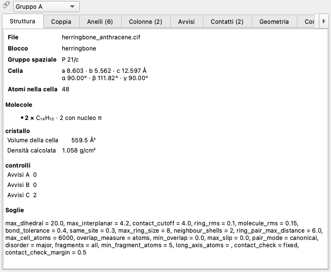

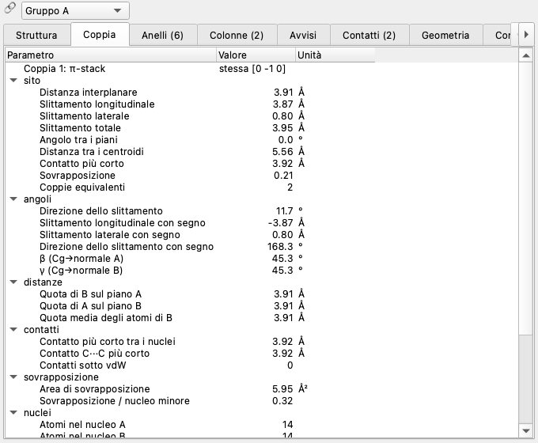

## 6. Grandezze misurate

Ogni grandezza è un *parametro del registro*: compare in tabella, negli assi di scatter e istogramma, nel Dettaglio e
negli export, con una chiave fissa (in inglese, uguale in ogni lingua). `pistak params` le elenca tutte.

**Parametri del sito** (gruppo *sito*)

| chiave | nome | unità | significato |
|---|---|---|---|
| `interplanar` | Distanza interplanare | Å | \|**d**·**n**\| |
| `long_slip` | Slittamento longitudinale | Å | componente dello slittamento lungo L |
| `lat_slip` | Slittamento laterale | Å | componente lungo W |
| `slip` | Slittamento totale | Å | \|**s**\| |
| `dihedral` | Angolo tra i piani | ° | angolo tra le normali (0–90°) |
| `centroid_distance` | Distanza tra i centroidi | Å | \|**d**\| |
| `contact` | Contatto più corto | Å | distanza minima tra atomi pesanti delle due molecole |
| `overlap` | Sovrapposizione | – | frazione degli atomi di un nucleo dentro il contorno dell'altro |
| `count` | Coppie equivalenti | – | contatti equivalenti per simmetria raccolti nella coppia |

**Parametri aggiuntivi**

| chiave | significato |
|---|---|
| `slip_angle` | direzione dello slittamento rispetto a L, 0–90° (0 = tutto longitudinale) |
| `long_slip_signed`, `lat_slip_signed` | componenti di **s** con segno, da A verso B |
| `slip_direction` | direzione di **s** con segno, −180…180°, da L verso W |
| `beta_a`, `beta_b` | angolo tra **d** e la normale di A (β) o di B (γ), stile Janiak |
| `height_b_over_a`, `height_a_over_b` | quota del baricentro di B sul piano di A e viceversa |
| `mean_atom_height` | quota media degli atomi del nucleo B sul piano di A |
| `core_contact`, `cc_contact` | contatto più corto tra i nuclei; tra due carboni |
| `n_vdw_contacts` | coppie di atomi pesanti più vicine della somma dei raggi di van der Waals |
| `overlap_area` | area comune dei contorni proiettati (Ų) |
| `overlap_ratio` | area comune / area del contorno minore (0–1) |
| `core_size_a/b`, `core_rms_a/b` | atomi e planarità dei due nuclei |
| `fragment_a/b` | numero del frammento π di A e di B |
| `axis_aspect_a/b` | isotropia del nucleo: vicino a 1 l'asse lungo non è definito (coronene, porfirine) |

**Slittamenti con segno.** Le versioni senza segno non distinguono B spostata «avanti» o «indietro» lungo L. Le
versioni con segno sì, ma il segno ha senso fisico solo se l'asse è definito da due atomi (vedi
[Asse lungo](#9-convenzioni-dellanalisi)) e la molecola non sta su un centro di inversione, che rovescia l'asse.
Scambiando A e B il segno cambia.

### Grandezze della struttura e controlli rapidi

Oltre ai parametri delle coppie, PISTAK calcola alcune grandezze dell'intero cristallo. Compaiono nella scheda
*Struttura* del Dettaglio, nella riga in più di `analyze`, nel JSON (`summary.structure`), nel CSV di `batch` e nelle
colonne Z′, R1 e Avvisi della finestra di confronto.

| chiave | significato |
|---|---|
| `volume` | volume della cella (ų) |
| `z`, `z_prime` | Z del CIF; Z′ = Z / numero di posizioni generali (unità formula indipendenti) |
| `density_calc` | densità dal modello: tutte le componenti disordinate, pesate con l'occupanza, per la molteplicità del sito |
| `density_cif`, `temperature` | densità e temperatura dichiarate nel CIF |
| `r1`, `wr2`, `goof`, `rho_max`, `rho_min` | indici dell'affinamento e densità residua, letti dal CIF |
| `alerts_a`, `alerts_b`, `alerts_c` | quanti avvisi di ciascun livello hanno dato i controlli rapidi |

I **controlli rapidi** sono una parte di ciò che controllano checkCIF e PLATON: quella che si può fare con il solo CIF,
senza il file dei fattori di struttura (.fcf). **Non sostituiscono checkCIF**: servono a trovare in fretta i problemi
che falsano l'analisi delle coppie. Livelli: **A** problema serio, **B** possibile problema, **C** da controllare,
**G** informazione. Le soglie sono indicative.

| controllo | che cosa guarda |
|---|---|
| formula | formula del modello per unità formula contro `_chemical_formula_sum` (B per gli atomi pesanti, C per gli idrogeni) |
| densità | densità calcolata contro quella dichiarata (C oltre 0,02 g/cm³, B oltre 0,1) |
| idrogeni | nessun idrogeno nel modello (B); carboni terminali senza idrogeni (C) |
| sovrapposizioni | atomi distinti a meno di 0,7 Å (A): disordine non risolto o atomi doppi |
| legami | C–C, C–N, C–O fuori dagli intervalli plausibili (B); C–H, N–H, O–H (C) |
| contatti | con `contact_check = "fixed"` (predefinito): C···C intermolecolari sotto 3,0 Å e H···H sotto 1,8 Å (C); con `"vdw"`: per ogni coppia di elementi, i contatti più corti della somma dei raggi di van der Waals di oltre `contact_check_margin` (0,5 Å), esclusi i legami a idrogeno plausibili (H legato a N o O verso N, O, F) (C, `vdwContact`) |
| affinamento | R1 > 0,075 (C) o > 0,10 (B), wR2 > 0,20 (C) o > 0,25 (B), GoF fuori da 0,8–2,0, densità residua > 1 e/ų per gli atomi leggeri |
| disordine | atomi esclusi dalla regola di disordine (G), occupanze parziali nel modello analizzato (C), operazioni di simmetria ricavate dal simbolo (G) |
| simmetria mancata | come ADDSYM di PLATON: il pacchetto `spglib` cerca il gruppo del modello; più operazioni di quelle dichiarate entro 0,1 Å → A, solo entro 0,3 Å → C (pseudosimmetria) |

Il controllo dei contatti si sceglie in **Analisi ▸ Soglie…** (*Controllo dei contatti corti* e *Margine*) o in
`user.toml`: le soglie fisse vedono solo carboni e idrogeni; la somma dei raggi vale per tutti gli elementi ed è la
stessa misura della scheda *Geometria*, dove ogni contatto ha la colonna *d − Σ r vdW*.

Da terminale: `./start.py check file.cif` (esce con codice 2 se ci sono avvisi A, comodo negli script; `--csv` li
scrive). Senza `spglib` installato la ricerca della simmetria mancata si salta con un avviso G.

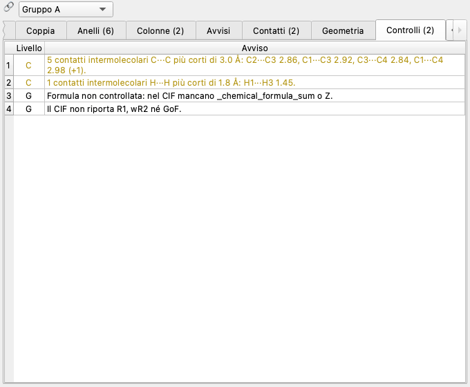

### Geometria delle molecole

Legami, angoli di legame e torsioni (con segno, −180…180°) delle sole molecole indipendenti per simmetria: per ogni
insieme di molecole equivalenti si prende quella con più atomi dell'unità asimmetrica come sono nel CIF. Gli atomi
generati da un'altra operazione portano un **codice di simmetria** come nei CIF di SHELXL: C2#1 è l'atomo C2 portato
dall'operazione #1, e la legenda sotto la tabella dice quale (per esempio `#1 = -x+1,-y,-z`). Le misure uguali per la
simmetria interna della molecola compaiono una volta, con meno atomi trasformati possibile.

I **contatti** sono le coppie di atomi di due molecole diverse (o di due copie della stessa) più vicine della somma dei
raggi di van der Waals (Bondi; H 1,10 Å), dal più corto in proporzione: oltre alla distanza danno la somma dei raggi e
la differenza *d − Σ r vdW*. Il primo atomo è sempre della molecola indipendente; ogni contatto equivalente per
simmetria compare una volta. Ci finiscono i legami a idrogeno (H···O e H···N sotto 2,6 Å), i contatti stretti delle
colonne di stack e gli scontri da controllare; quelli più corti di 3,0 Å tra carboni e di 1,8 Å tra idrogeni
diventano anche avvisi dei controlli rapidi.

Le **s.u.** si propagano dalle s.u. delle coordinate del CIF (tenendo conto che C1 e C1#1 si muovono insieme); mancano
per gli atomi senza s.u., di solito gli idrogeni in posizione calcolata. Rispetto alle tabelle `_geom_` scritte dal
programma di affinamento possono scostarsi un po', perché qui la cella è considerata esatta e le coordinate
indipendenti tra loro (il CIF non riporta le loro correlazioni): di più per le misure tra un atomo e la sua immagine
per simmetria.

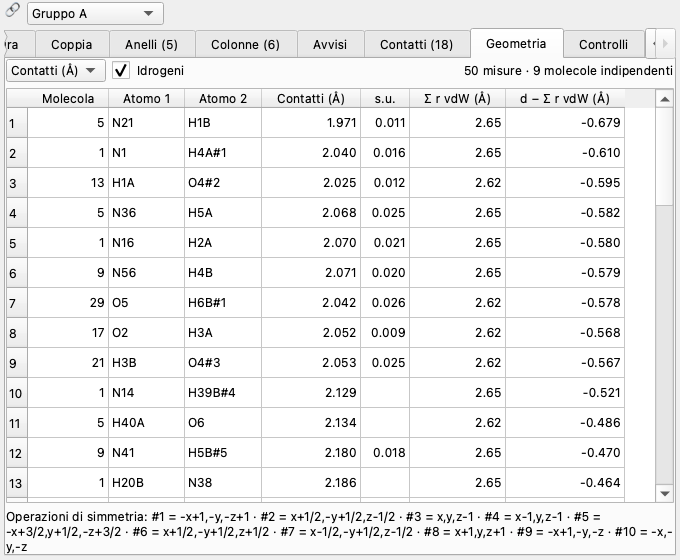

Dove: Dettaglio ▸ *Geometria*, *File ▸ Esporta ▸ Geometria delle molecole (CSV)* e `./start.py geom file.cif`
(`--kind bond,angle,torsion,contact`, `--no-h`, `--csv`).

## 7. Classificazione e soglie

Una coppia è:

1. **inclinata** se l'angolo tra i piani supera `max_dihedral`;
2. altrimenti **π-stack** se la distanza interplanare è al massimo `max_interplanar`, la sovrapposizione supera
   `min_overlap` e, se `max_slip` > 0, lo slittamento totale è al massimo `max_slip`;
3. altrimenti **parallela**.

La sovrapposizione del criterio si misura come frazione di atomi dentro il contorno dell'altro nucleo
(`overlap_measure = "atoms"`, il sito: basta un atomo) o come area comune / area del nucleo minore (`"area"`, più
severo e continuo: con `min_overlap = 0.3` servono almeno 30% di area coperta).

Le soglie si cambiano da **Analisi ▸ Soglie…** (tutte), dal pannello **Soglie in tempo reale** (quelle del
criterio), da `user.toml` o dal terminale.

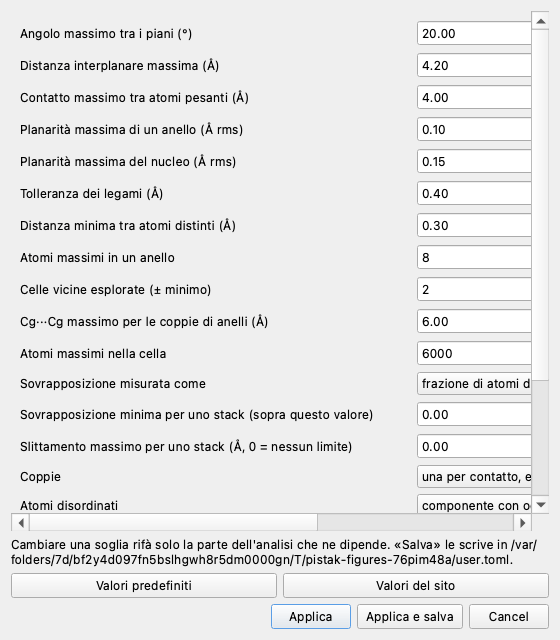

| soglia | predefinito | significato |
|---|---|---|
| `max_dihedral` | 20° | sopra, la coppia è inclinata |
| `max_interplanar` | 4,2 Å | sopra, niente π-stack |
| `contact_cutoff` | 4,0 Å | due molecole sono vicine se hanno atomi pesanti più vicini di così |
| `overlap_measure` | atoms | come si misura la sovrapposizione (atoms / area) |
| `min_overlap` | 0 | sovrapposizione minima per una π-stack |
| `max_slip` | 0 Å | slittamento massimo per una π-stack (0 = nessun limite) |
| `ring_rms` | 0,10 Å | planarità massima di un anello |
| `molecule_rms` | 0,15 Å | planarità massima del nucleo intero |
| `max_ring_size` | 8 | atomi massimi in un anello |
| `bond_tolerance` | 0,4 Å | legame se la distanza è sotto la somma dei raggi covalenti più questo |
| `same_site` | 0,3 Å | due posizioni più vicine di così sono lo stesso atomo |
| `neighbour_shells` | 2 | celle vicine esplorate (minimo: in modalità canonical si allarga da sola) |
| `ring_pair_max_distance` | 6,0 Å | Cg···Cg massimo per la tabella degli anelli |
| `max_cell_atoms` | 6000 | limite di atomi nella cella |
| `pair_mode` | canonical | come si raccolgono le coppie (canonical / site) |
| `disorder` | major | quali atomi disordinati tenere |
| `fragments` | all | tutti i frammenti π o solo il più grande |
| `min_fragment_atoms` | 5 | atomi minimi di un frammento secondario |
| `long_axis_atoms` | (vuoto) | asse lungo da due etichette, es. `C1,C9` |
| `contact_check` | fixed | controllo rapido dei contatti corti: soglie fisse (fixed) o somma dei raggi di van der Waals (vdw) |
| `contact_check_margin` | 0,5 Å | con `vdw`: quanto sotto la somma dei raggi deve stare un contatto per l'avviso |

**Valori del sito** (nella finestra delle soglie) riporta tutto alle convenzioni dell'analizzatore originale:
`pair_mode = site`, `disorder = first`, `fragments = largest`.

## 8. Soglie in tempo reale

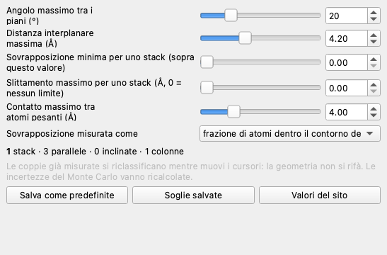

**Analisi ▸ Soglie in tempo reale** (Ctrl+Maiusc+L) apre un pannello con un cursore per ogni soglia del criterio di
stack. Mentre muovi un cursore le coppie si riclassificano subito: tabella, scatter (con le linee delle soglie),
istogramma, colonne e conteggi in fondo al pannello seguono il cursore; la coppia selezionata e i filtri restano gli
stessi. Così si vede a colpo d'occhio quanto una classificazione dipende dalle soglie.

Perché è veloce: l'analisi è divisa in **stadi** e ogni soglia appartiene a uno solo.

| stadio | soglie | che cosa si rifà |
|---|---|---|
| cif | `disorder` | lettura del file |
| struttura | `bond_tolerance`, `same_site`, `max_cell_atoms` | cella, legami, molecole |
| frammenti | `ring_rms`, `molecule_rms`, `max_ring_size`, `fragments`, `min_fragment_atoms`, `long_axis_atoms` | anelli, frammenti, assi |
| contatti | `contact_cutoff`, `neighbour_shells`, `pair_mode` | misura di tutte le coppie (la parte costosa) |
| coppie | `max_dihedral`, `max_interplanar`, `min_overlap`, `max_slip`, `overlap_measure`, `ring_pair_max_distance`, `contact_check`, `contact_check_margin` | classificazione, raccolta, colonne (le ultime due rifanno solo i controlli rapidi) |

Cambiando una soglia si riparte dal suo stadio e si riusa il resto. Con le soglie del criterio di stack nessuna
geometria si rimisura (pochi millisecondi). Il *contatto massimo* invece decide quali coppie misurare: si applica
quando lasci il cursore, in un thread a parte.

*Salva come predefinite* scrive le soglie in `user.toml`; *Soglie salvate* torna a quelle; *Valori del sito* mette le
soglie del criterio del sito. Dopo un cambio di soglie le incertezze del Monte Carlo vanno ricalcolate.

## 9. Convenzioni dell'analisi

**Coppie: canonical o site** (`pair_mode`).

* `canonical` (predefinito): ogni contatto tra due molecole compare una volta. Due contatti sono la stessa coppia se
  un'operazione del gruppo spaziale porta l'uno nell'altro; *Coppie equivalenti* conta i contatti per cella. L'asse
  L è la bisettrice degli assi lunghi dei due frammenti, quindi gli slittamenti non dipendono da quale molecola si
  chiama A. Le celle vicine esplorate si allargano da sole quanto serve (celle piccole o molto oblique).
* `site`: come il sito originale. Ogni contatto compare due volte (a→b e b→a, con slittamenti che possono differire,
  perché L è l'asse della prima molecola); le coppie «equivalenti» si riconoscono dai valori arrotondati; si
  esplorano sempre ±`neighbour_shells` celle. Serve per confrontare i numeri con il sito.

**Frammenti π** (`fragments`). Con `all` una molecola con più sistemi aromatici separati (un bifenile ruotato, un
ligando con più anelli) ha un frammento per sistema; le coppie sono tra frammenti, comprese quelle tra frammenti della
stessa molecola (*intramolecolari*). **Dettaglio ▸ Contatti** raccoglie le coppie di frammenti per contatto tra
molecole. Con `largest` conta solo π1, come il sito.

**Asse lungo** (`long_axis_atoms`). Vuoto: la direzione di massima estensione del frammento. Per nuclei quasi
isotropi (*Isotropia del nucleo A/B* vicina a 1: benzene, coronene, porfirine) questa direzione è mal definita, e così la
divisione dello slittamento in L e W. Con due etichette del CIF (`C1,C9`) l'asse va dal primo atomo al secondo,
proiettato sul piano, per i frammenti che li contengono. Se un'etichetta compare più volte nella molecola (molecola su
un elemento di simmetria) si prende la coppia più lontana: anche `C1,C1` va bene.

**Disordine** (`disorder`). `major` (predefinito): per ogni assemblaggio di disordine tiene il gruppo con l'occupanza
media più alta; `first`: il gruppo 1 (il sito); `all`: tutti gli atomi; un numero: quel gruppo. Quanti atomi sono
stati scartati lo dice **Dettaglio ▸ Struttura** (e `skipped_disorder_atoms` nel JSON).

**Più strutture in un file.** Ogni blocco `data_` con atomi è una struttura: la finestra chiede quale aprire, il
confronto le analizza tutte («file.cif [blocco]»), `analyze --block NOME` ne sceglie una.

**Operazioni di simmetria mancanti.** Se il CIF non le elenca si ricavano dal simbolo di Hall o dal simbolo
Hermann–Mauguin (tabella dei gruppi più comuni; tutti con il pacchetto facoltativo `gemmi`). L'export JSON dice da dove
vengono (`symops_source`).

**Molecole estese.** Se la rete di legami non si chiude (polimeri, MOF, solidi ionici estesi) quelle parti sono
escluse dall'analisi e segnalate in **Dettaglio ▸ Struttura**.

## 10. Colonne di stack

Le coppie π-stack sono gli archi di un grafo sulle molecole del cristallo. Percorrendolo PISTAK riconosce le
**colonne**, classificate per *rango* (quante direzioni indipendenti di impilamento hanno):

| rango | tipo | esempio |
|---|---|---|
| 0 | aggregato finito | dimero, trimero isolato |
| 1 | colonna | impilamento infinito lungo un asse (il caso classico) |
| 2 | strato | molecole impilate in due direzioni |
| 3 | rete 3D | contatti di stack in tre direzioni |

Per le colonne **Dettaglio ▸ Colonne** dà il passo (Å), l'asse in celle, la geometria media e l'angolo tra l'asse
della colonna e la normale ai piani; la 3D, con *Colonna*, mostra le altre molecole della colonna.

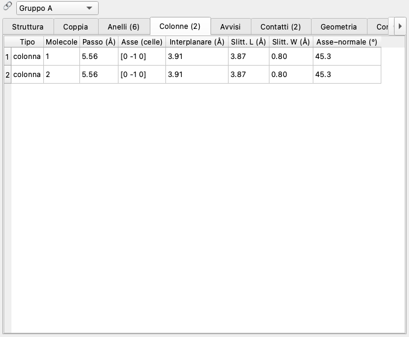

## 11. Incertezze con il Monte Carlo

**Analisi ▸ Incertezze (Monte Carlo)…** stima la deviazione standard σ di ogni parametro a partire dalle incertezze
standard (s.u.) del CIF, le cifre tra parentesi: `0.1234(5)`. Per N campioni (200 è un buon valore) le coordinate
di ogni atomo dell'unità asimmetrica vengono spostate a caso secondo le loro s.u. (e, a scelta, i parametri di cella);
lo spostamento passa alle copie per simmetria attraverso l'operazione che le genera, quindi le molecole equivalenti si
muovono in modo coerente. Si ricalcolano piani e assi e si rimisura ogni coppia: σ è la deviazione standard sui
campioni. Per ogni coppia si calcola anche la frazione dei campioni in cui il tipo (stack/parallela/inclinata) resta lo
stesso (*kind_agreement*): sotto 1 la classificazione è al limite delle soglie.

Il Dettaglio mostra «valore ± σ»; il CSV aggiunge le colonne `<chiave>_su` e `kind_agreement`, il JSON un campo `su`
per coppia. Da terminale: `analyze file.cif --mc 200`.

Approssimazioni (le stesse dei programmi cristallografici senza matrice di covarianza): coordinate indipendenti,
posizioni speciali non vincolate, atomi senza s.u. fermi. Una σ grande sugli slittamenti L e W di un nucleo quasi
isotropo dice che l'asse lungo non è definito: conviene fissarlo con due atomi.

## 12. Confronto e statistiche su più strutture

**Analisi ▸ Confronto e statistiche…** (Ctrl+Maiusc+C) apre una finestra dove si aggiungono file e cartelle di CIF
(*Aggiungi CIF…*, *Aggiungi cartella…* o trascinandoli): l'analisi gira in parallelo e tutte le coppie di tutti i
file finiscono nella stessa tabella. Il filtro *Coppie* (solo π-stack, parallele, inclinate, tutte) e *Pesa per coppie
equivalenti* valgono per tutte le schede.

| scheda | contenuto |
|---|---|
| Strutture | per ogni struttura la coppia π-stack più vicina, le differenze Δ dal riferimento (tasto destro ▸ *Imposta come riferimento*) e la *distanza del motivo*: la distanza (Å) nello spazio (interplanare, slittamento L, slittamento W) tra i due motivi di stack più simili; poi Z′, R1 e il numero di avvisi A/B/C dei controlli rapidi. Doppio clic: apre il file nella finestra principale |
| Distribuzioni | istogramma di qualunque parametro, impilato per tipo o per file |
| Dispersione | due parametri, colore per tipo, file o un terzo parametro; *Apri nella finestra principale* porta alla coppia scelta |
| Correlazioni | matrice di Pearson tra i parametri spuntati |
| Riepilogo | media, deviazione standard, minimo, quartili, massimo; una riga per file |

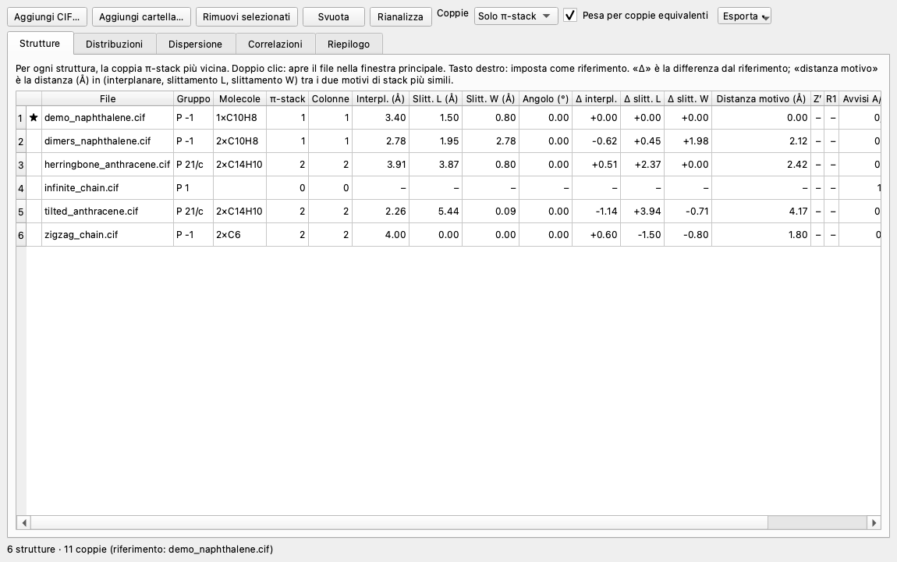

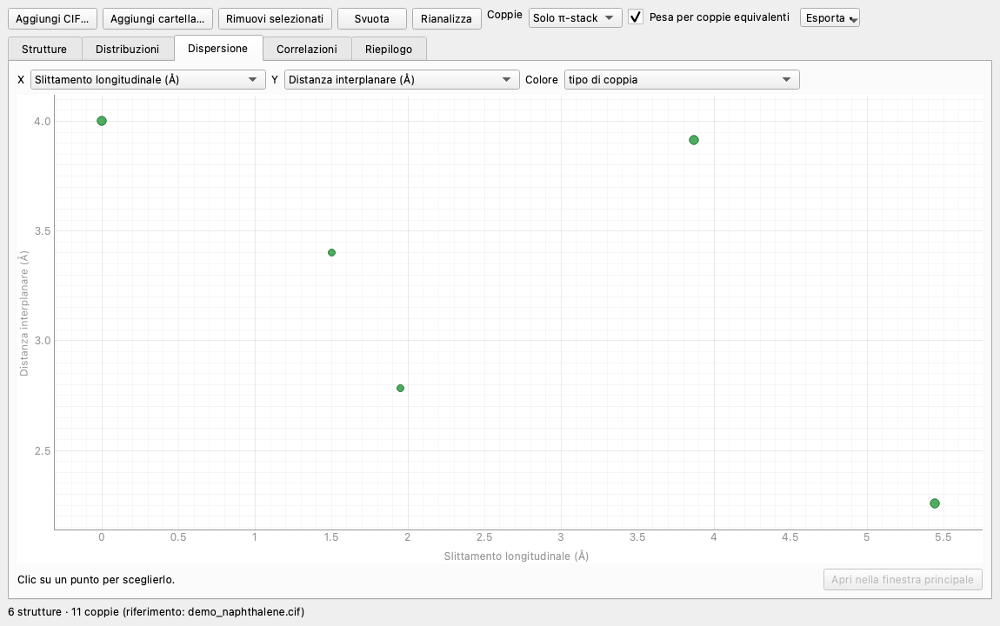

Tutto si esporta in CSV dal menu *Esporta ▾*. Da terminale: `compare` e `stats` (vedi [Il terminale](#15-il-terminale)).

## 13. Esportare i risultati

**File ▸ Esporta**:

* **Tabella delle coppie (CSV)**: una riga per coppia, colonne `n, kind, molecule_a, molecule_b, shift` e poi un
  parametro per colonna (le chiavi del registro), più `<chiave>_su` e `kind_agreement` se ci sono le incertezze.
* **Risultati completi (JSON)**, versione 4: `format`, `version`, `summary` (file, gruppo, cella, molecole, soglie,
  disordine, incertezze, grandezze della struttura in `structure`, avvisi dei controlli in `alerts`), `units`,
  `structure_units`, `symops` (le operazioni di simmetria), `molecule_list` (ogni molecola numerata come nelle
  coppie: formula, atomi, etichette, baricentro, se è estesa e se è indipendente per simmetria), `fragments` (frammenti π
  con le etichette degli atomi), `pairs` (con tutti i parametri), `molecule_contacts`, `stacks` (colonne di stack: tipo,
  molecole, traslazioni, passo, coppie), `ring_pairs` (coppie di anelli di ogni coppia, con il numero `pair`) e
  `geometry` (`bonds`, `angles`, `torsions`, `contacts` delle molecole indipendenti: atomi, `symops`, valore, s.u.; per i
  contatti `molecule_b`, `vdw_sum` e `delta`).
* **Coppia selezionata (XYZ)**: le due molecole, B già nella cella giusta, da aprire in qualunque visualizzatore.
* **Coppia selezionata per calcoli quantistici**: vedi la sezione seguente.
* **Cella per calcoli periodici**: vedi [Cella intera per calcoli periodici](#cella-intera-per-calcoli-periodici).
* **Geometria delle molecole (CSV)**: `kind` (bond, angle, torsion, contact), `molecule`, `atom_1`…`atom_4`, `symop_1`…`symop_4` (l'operazione che genera ogni atomo; vuota per l'atomo del CIF), `value`, `su`, e per i contatti `vdw_sum` e `delta`.
* **Avvisi dei controlli rapidi (CSV)**: `level`, `code`, `values`.
* **Vista 3D (PNG)**.

Intestazioni e chiavi sono fisse e in inglese, uguali in ogni lingua dell'interfaccia: uno script che legge i file
funziona sempre. Esempio di CSV:

```text
n,kind,molecule_a,molecule_b,shift,interplanar,long_slip,lat_slip,slip,dihedral,...
1,stack,1,1,0 -1 0,3.9138,3.8692,0.80441,3.952,0,...
```

## 14. Dimero per calcoli quantistici

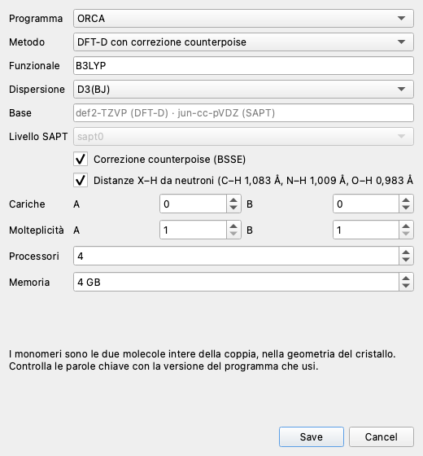

**File ▸ Esporta ▸ Coppia selezionata per calcoli quantistici…** scrive l'input per **ORCA**, **Psi4** o
**Gaussian** del dimero della coppia selezionata, per calcolarne l'energia di interazione.

* **Monomeri**: le due molecole intere della coppia, nella geometria del cristallo (B già traslata nella cella giusta).
  Anche per un contatto tra frammenti l'energia è quella dell'intero dimero.
* **Idrogeni**: le distanze X–H da raggi X sono troppo corte; per impostazione ogni X–H viene allungato lungo il legame
  alle distanze medie da diffrazione di neutroni (C–H 1,083 Å, N–H 1,009 Å, O–H 0,983 Å, B–H 1,19 Å, S–H 1,338 Å).
  Gli atomi pesanti non si muovono.
* **DFT-D** (predefinito B3LYP-D3(BJ)/def2-TZVP) con correzione counterpoise (Boys–Bernardi):
  E_int = E(AB) − E(A nella base AB) − E(B nella base AB). ORCA: tre calcoli nello stesso file (`$new_job`) con
  atomi fantasma; Psi4: `bsse_type='cp'`; Gaussian: `Counterpoise=2` con i frammenti (Gaussian non ha D4).
* **SAPT** (solo Psi4, predefinito SAPT0/jun-cc-pVDZ): energia scomposta in elettrostatica, scambio, induzione e
  dispersione, utile per capire *perché* uno stack è stabile.
* Cariche e molteplicità dei monomeri, processori e memoria vanno nelle intestazioni del programma.

Il file inizia con un commento che dice da dove viene (CIF, blocco, coppia, distanze, idrogeni spostati) ed è tutto
ASCII; come gli altri export, commenti e nome del file sono in inglese in ogni lingua (`herringbone_anthracene_pair1_dftd.inp`).
Esempio (ORCA, prime righe):

```text
# PISTAK: herringbone_anthracene.cif [herringbone] pair 1 (stack)
# molecule 1 + molecule 1 translated by [0 -1 0]
# interplanar 3.914 A, slip L 3.869 A, W 0.804 A, angle 0.0 deg, contact 3.922 A
# X-H distances set to neutron values (20 hydrogens moved)
# experimental crystal geometry, not optimised
# DFT-D with counterpoise correction (Boys-Bernardi): E_int = E(AB) - E(A in AB basis) - E(B in AB basis)
# --- dimer AB
! B3LYP D3BJ def2-TZVP TightSCF DefGrid2
%pal nprocs 4 end
%maxcore 1000
* xyz 0 1
C          -0.93338175     0.74220151     0.73344970
```

Da terminale, per esempio tutti gli stack di un file come input SAPT per Psi4:

```bash
./start.py qc a.cif --program psi4 --method sapt -o input/
```

Le coppie intramolecolari non si esportano (non sono un dimero). Le parole chiave seguono le versioni correnti
(ORCA 5–6, Psi4 1.7+, Gaussian 16): controllale con la versione che usi.

### Cella intera per calcoli periodici

*File ▸ Esporta ▸ Cella per calcoli periodici…* scrive tutta la cella per un codice periodico: struttura a bande,
DOS, energia di reticolo, ottimizzazione con la cella. Si sceglie il programma, il calcolo (energia, ottimizzazione
degli atomi, di atomi e cella), il funzionale, la dispersione e la lunghezza L per la griglia di punti k
(n = ⌈L / a⌉ lungo ogni asse; 20 Å va bene per gli isolanti molecolari).

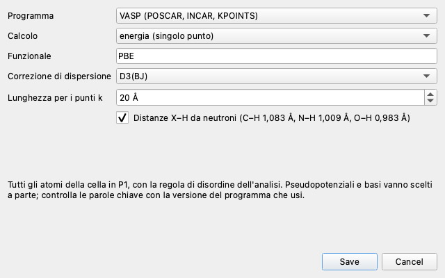

| programma | file | note |
|---|---|---|
| VASP | `POSCAR`, `INCAR`, `KPOINTS` in una cartella | `GGA` (PBE, PBEsol…), `IVDW` 11/12/13 per D3, D3(BJ), D4; il `POTCAR` va composto nell'ordine della riga 6 del POSCAR |
| Quantum ESPRESSO | `file.pw.in` | `vdw_corr = 'grimme-d3'`; i nomi degli pseudopotenziali (`C.UPF`…) sono segnaposto da sostituire (per esempio con la libreria SSSP) |
| CP2K | `file.inp` | solo il punto Γ: con un lato della cella corto conviene una supercella (il file lo segnala); basi MOLOPT e pseudopotenziali GTH |
| CRYSTAL | `file.d12` e `file.notes.txt` | cella in P1, base pob-TZVP-rev2, `DFTD3`; il formato non ammette commenti, la provenienza sta nel file di note |

Gli atomi sono quelli della cella ricostruita, con la stessa regola di disordine dell'analisi (le occupanze parziali
non si possono dare a un codice periodico: se ce ne sono, il file lo avverte) e, come per il dimero, gli idrogeni alle
distanze X–H da neutroni. Da terminale:

```bash
./start.py periodic a.cif --program qe --task vc-relax --kpoint-length 25 -o calcoli/
```

Senza `-o` Quantum ESPRESSO e CP2K scrivono sul terminale, VASP e CRYSTAL in una cartella `<file>_<programma>/`.

## 15. Il terminale

Tutto ciò che fa la finestra si fa anche da terminale (`./start.py COMANDO …` oppure `pistak COMANDO …`).

| comando | a che cosa serve |
|---|---|
| `analyze file.cif` | analizza un file e stampa le coppie; `--csv`, `--json`, `--xyz N FILE`, `--block`, `--mc N` |
| `batch cartella/` | tutti i CIF di una cartella, in parallelo; `--csv riepilogo.csv` |
| `compare a.cif b.cif …` | confronto del motivo di stack; `--ref N` sceglie il riferimento |
| `stats cartella/` | statistiche sulle coppie; `--kind stack`, `--keys`, `--corr`, `--csv`, `--summary` |
| `qc file.cif` | input del dimero per ORCA, Psi4, Gaussian (vedi sopra) |
| `periodic file.cif` | la cella intera per VASP, Quantum ESPRESSO, CP2K, CRYSTAL; `--program`, `--task`, `--kpoint-length`, `-o` |
| `check file.cif` | controlli rapidi della struttura; `--csv`; codice d'uscita 2 se ci sono avvisi A |
| `geom file.cif` | legami, angoli, torsioni e contatti di van der Waals con le s.u. e i codici di simmetria; `--kind`, `--no-h`, `--csv` |
| `params` | elenca i parametri disponibili, plugin compresi |
| `config` | dove stanno impostazioni personali, ultima sessione e plugin |
| `demo` | scrive il CIF dimostrativo |
| `gui` | apre la finestra |

Ogni comando di analisi accetta le soglie: `--max-dihedral`, `--max-interplanar`, `--contact-cutoff`,
`--pair-mode`, `--disorder`, `--overlap-measure`, `--min-overlap`, `--max-slip`. `--lang en` (o `PISTAK_LANG=en`)
cambia la lingua dei messaggi.

**Esempio: un file.**

```text
$ ./start.py analyze examples/herringbone_anthracene.cif
herringbone_anthracene.cif  gruppo P 21/c  a=8.603 b=5.562 c=12.597  α=90.00 β=111.82 γ=90.00  atomi in cella: 48
  2 × C14H10  (2 con nucleo π)
  Volume della cella 559.5 ų · Densità calcolata 1.058 g/cm³
  controlli rapidi: 0 avvisi A, 0 B, 2 C (dettagli: pistak check)
  # tipo     interpl.  L-slip  W-slip  diedro   Cg-Cg contatto  relazione
  1 stack        3.91    3.87    0.80     0.0    5.56     3.92  stessa [0 -1 0]
  2 tilted       5.85    2.78    2.33    89.4    6.88     2.45  molecola 2 [0 -1 -1]
```

**Esempio: confronto di una cartella**, rispetto alla prima struttura.

```text
$ ./start.py compare examples/ --ref 1
file                         stack col interplan long_slip  lat_slip  dihedral   Δ rispetto al rif.   dist.motivo
demo_naphthalene.cif             1   1      3.40      1.50      0.80      0.00    +0.00  +0.00  +0.00     0.00 Å
dimers_naphthalene.cif           1   1      2.78      1.95      2.78      0.00    -0.62  +0.45  +1.98     2.12 Å
herringbone_anthracene.cif       2   2      3.91      3.87      0.80      0.00    +0.51  +2.37  +0.00     2.42 Å
```

**Esempio: statistiche sugli stack di una cartella.**

```text
$ ./start.py stats examples/ --kind stack
parametro                n    media  dev.st.      min      q25  mediana      q75      max
interplanar              8    3.316    0.723    2.258    2.609    3.571    3.957    4.000
long_slip                8    2.760    2.072    0.000    1.000    2.591    4.657    5.444
```

**Esempio: soglie più severe e incertezze.**

```bash
./start.py analyze a.cif --overlap-measure area --min-overlap 0.3 --max-slip 2.5 --mc 200 --csv a.csv
```

## 16. Sessioni

**File ▸ Salva la sessione…** scrive un file `.pistak` (JSON leggibile) con il CIF incorporato (la sessione si apre
anche se sposti il file), le soglie, la coppia selezionata e il filtro di ogni gruppo, le viste con le loro impostazioni
(assi, colonne, opzioni e camera della 3D), la disposizione dei pannelli e i file della finestra di confronto. Si
riapre da **File ▸ Apri una sessione…**, trascinando il file sulla finestra o con `./start.py sessione.pistak`.
Alla chiusura l'ultima sessione si salva da sola: **File ▸ Riapri l'ultima sessione**.

## 17. Impostazioni personali

Le impostazioni personali stanno fuori dal programma, nella cartella dell'utente (`./start.py config` la mostra):

* macOS `~/Library/Application Support/PISTAK/`
* Windows `%APPDATA%\PISTAK\`
* Linux `~/.config/pistak/`
* oppure quella indicata dalla variabile `PISTAK_CONFIG_DIR`.

Contiene `user.toml`, `last.pistak` (l'ultima sessione) e `plugins/`. In `user.toml` si scrive solo ciò che si vuole
cambiare rispetto a `pistak/default.toml`:

```toml
[limits]
max_interplanar = 3.8
overlap_measure = "area"
min_overlap = 0.25
long_axis_atoms = "C1,C9"

[gui]
language = "en"          # it | en | auto
show_hydrogens = false
sphere_scale = 0.3
```

## 18. PISTAK come libreria Python

Il calcolo non dipende dalla finestra: si usa da uno script o da un notebook.

```python
from pistak import api
from pistak.core.config import Limits

a = api.analyse_file("examples/herringbone_anthracene.cif", Limits())
for p in a.pairs:
    print(p.index + 1, p.kind, round(p.interplanar, 2), round(p.get("long_slip_signed"), 2))

stack = next(p for p in a.pairs if p.kind == "stack")
ctx = a.pair_context(stack)            # tutto sulla coppia: molecole, nuclei, sistema (L, W, n)
print(ctx.frame.n, ctx.core_a.centroid)

b = api.reanalyse(a, a.limits.with_values(max_interplanar=3.8))   # rifà solo lo stadio necessario
u = api.uncertainty(a, samples=200)                                # σ dalle s.u. del CIF
print(u.get(stack, "interplanar"))

from pistak.io import export, qc
export.write_json(a, "a.json")
print(qc.dimer_input(a, stack, qc.QCOptions("psi4", "sapt")))
```

Per molte strutture, in parallelo:

```python
from pistak.io import batch, compare

entries = batch.run_batch(batch.find_cifs("cartella/"), Limits())   # una voce per blocco data_
for row in compare.compare(entries, reference=0):
    print(row)
```

`pistak.io.stats` calcola descrizioni statistiche, correlazioni e istogrammi sulle stesse voci.

## 19. Parametri nuovi con i plugin

Un parametro è una funzione che riceve il contesto della coppia e restituisce un numero. Copia
`plugins/example_param.py` nella cartella `plugins/` (del progetto o delle impostazioni personali), modificala e usa
**Analisi ▸ Ricarica i plugin**: il parametro compare in tabella, negli assi, nel Dettaglio e negli export.

```python
from pistak.params import parameter


@parameter("slip_over_distance", "Slittamento / distanza centroidi", unit="", group="plugin", digits=3,
           description="0 = nuclei sovrapposti, 1 = affiancati.")
def slip_over_distance(ctx):
    return ctx.pair.slip / ctx.pair.centroid_distance
```

Nel contesto `ctx` ci sono la coppia (`ctx.pair`), le due molecole (`ctx.A`, `ctx.B`), i nuclei (`ctx.core_a`,
`ctx.core_b`), il sistema della coppia (`ctx.frame.L/W/n`), le posizioni (`ctx.pos_a`, `ctx.pos_b`, con B già nella
cella giusta), le soglie e l'analisi intera. Se il valore dipende solo dalla geometria della coppia, dichiaralo con
`geometric=True`: verrà riusato quando cambiano le soglie di stack invece di essere ricalcolato. Un plugin che
fallisce dà NaN su quella coppia e l'errore compare in **Dettaglio ▸ Avvisi**: non ferma l'analisi.

## 20. Problemi frequenti

**Le viste restano vuote: «Nessuna coppia di nuclei π da mostrare».** Al posto della tabella, dello scatter e delle
altre viste delle coppie compare il motivo, con i numeri (lo ripetono la cima di **Dettaglio ▸ Struttura** e
`analyze`):

* *anelli saturi*: gli anelli ci sono ma non sono planari (a sedia, a busta: scarto dal piano medio ben sopra
  `ring_rms`) e hanno carboni con quattro legami, quindi niente elettroni π. È il caso di molti prodotti naturali e
  zuccheri: PISTAK non ha nulla da misurare, ed è giusto così;
* *anelli insaturi o quasi planari*: forse aromatici distorti; alza `ring_rms` (e se serve `molecule_rms`);
* *nessun anello* e molecola non planare; *rete di legami estesa* (polimero o solido, nessuna molecola separata);
* *nuclei π troppo lontani*: ci sono, ma nessuna coppia entro `contact_cutoff`.

In ogni caso restano disponibili **Dettaglio ▸ Struttura, Geometria e Controlli** e i comandi `check` e `geom`.

**La struttura ha atomi disordinati.** Con `disorder = major` si tiene la componente maggiore; per la minore usa il
numero del gruppo (`--disorder 2`), per tutto `all`. Quanti atomi sono stati scartati lo dice **Dettaglio ▸ Struttura**.

**«Troppi atomi nella cella».** Strutture grandi (proteine, MOF): alza `max_cell_atoms` nelle soglie.

**Gli slittamenti L e W cambiano molto con piccole variazioni.** Il nucleo è quasi isotropo (*Isotropia del nucleo
A/B* vicina a 1): fissa l'asse lungo con due atomi (`long_axis_atoms`).

**I numeri non coincidono con quelli del sito.** Usa *Valori del sito* nella finestra delle soglie (o
`--pair-mode site --disorder first`): le convenzioni predefinite di PISTAK sono diverse (vedi
[Convenzioni](#9-convenzioni-dellanalisi)).

**La vista 3D non compare.** Serve OpenGL; su macchine remote o virtuali può mancare. Le altre viste funzionano lo
stesso; `PISTAK_NO_3D=1` la disattiva del tutto.

**Il terminale mostra «qt.qpa.window: Can not manage visual effect areas…».** È un avviso innocuo di macOS sulla
finestra 3D; PISTAK lo filtra.

**Su dischi exFAT o FAT compaiono file `._nome`.** Li crea macOS; PISTAK li ignora e `start.py` li toglie
dall'ambiente. Se possibile, tieni il progetto su un disco APFS.
